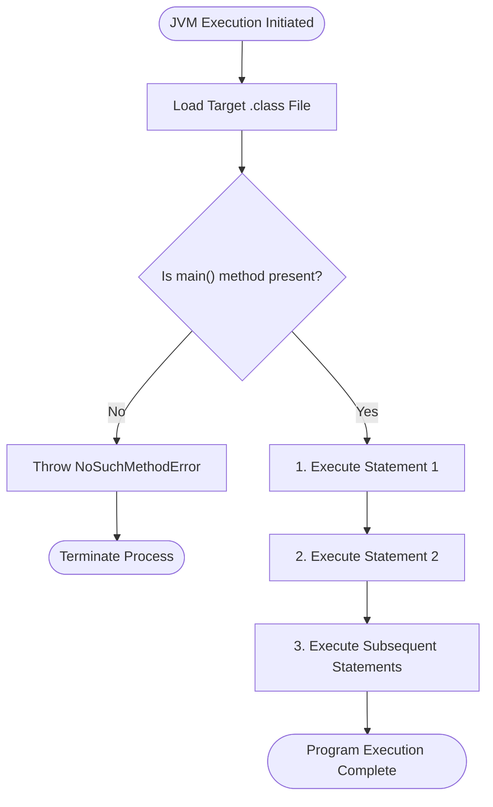

# Basic Syntax in Java

## Overview

Syntax is the set of rules that defines how a Java program is written, structured, and executed by the compiler. In Java, all instructions reside inside classes, execute sequentially through methods, format output to the console, and use comments for documentation. This guide provides a unified reference for fundamental Java syntax rules, class structures, execution flow, output mechanisms, and commenting practices.

This guide covers:

- **Class and file structure** - defining class containers, public accessibility, and PascalCase naming rules
- **The main method** - understanding JVM execution entry points and keyword breakdowns
- **Statements and execution flow** - enforcing statement termination with semicolons and top-to-bottom order
- **Console output techniques** - comparing `print()` vs. `println()`, text strings, and calculations
- **Comments and documentation** - applying single-line and multi-line commenting best practices
- **Common pitfalls and error analysis** - fixing syntax bugs, case sensitivity issues, and missing quotes

---

## Table of Contents

1. [Class and File Structure](#class-and-file-structure)
2. [The Main Method](#the-main-method)
3. [Java Statements and Semicolons](#java-statements-and-semicolons)
4. [Sequential Execution](#sequential-execution)
5. [Console Output](#console-output)
6. [Printing Text vs Numbers and Calculations](#printing-text-vs-numbers-and-calculations)
7. [Java Comments](#java-comments)
8. [Program Execution Flowchart](#program-execution-flowchart)
9. [Pure Java Code Examples](#pure-java-code-examples)
10. [Common Mistakes and Errors](#common-mistakes-and-errors)
11. [Exercises](#exercises)
12. [Quick Reference](#quick-reference)
13. [Related Topics](#related-topics)
14. [Why This Matters](#why-this-matters)
15. [Additional Resources](#additional-resources)

---

## Class and File Structure

### What is a Class in Java?

In Java, **all code must reside inside a class**. A class serves as a blueprint and container for your program's data and methods.

```java
public class Main {
    // Code goes here
}
```

### Essential Naming Rules

1. **Exact Matching:** The file name **must match** the name of the `public class` exactly, including capitalization, followed by the `.java` extension.
* Class `Main` $\rightarrow$ File name: `Main.java`
* Class `UserProfile` $\rightarrow$ File name: `UserProfile.java`


2. **Case Sensitivity:** Java is strictly case-sensitive. `MyClass`, `myclass`, and `MYCLASS` are treated as distinct identifiers.
3. **PascalCase Convention:** Class names always start with an uppercase letter and capitalize the first letter of each subsequent word (e.g., `CalculatorDemo`).

---

## The Main Method

### The Entry Point

The `main()` method is required in every executable Java application. It serves as the starting point of execution for the Java Virtual Machine (JVM).

```java
public class Main {
    public static void main(String[] args) {
        // Program execution begins here
    }
}
```

### Method Keywords Breakdown

| Keyword | Meaning |
| --- | --- |
| `public` | Accessible from anywhere by the Java runtime environment |
| `static` | Belongs to the class itself (runs without instantiating an object) |
| `void` | Returns no value upon completion |
| `main` | The mandatory method name recognized by the JVM entry point |
| `String[] args` | Array parameter that stores command-line arguments |

---

## Java Statements and Semicolons

### What is a Statement?

A statement is an individual command or instruction that performs a specific action in Java.

```java
System.out.println("Java is fun!");
```

### The Semicolon Rule

* Every individual Java statement **must end with a semicolon `;**`.
* Just as sentences end with a period (`.`) in natural language, Java statements terminate with a semicolon (`;`).
* Omitting a semicolon produces a compilation error (`error: ';' expected`).

---

## Sequential Execution

Statements inside a method run **sequentially**—one after another, in the exact top-to-bottom order in which they appear in the source code.

```java
public class StatementOrder {
    public static void main(String[] args) {
        System.out.println("Hello World!");          // Executed 1st
        System.out.println("Have a good day!");     // Executed 2nd
        System.out.println("Learning Java is fun!"); // Executed 3rd
    }
}
```

---

## Console Output

Java provides two main methods inside `System.out` to write values or text to the standard output console.

### 1. The `println()` Method

Outputs the provided value and automatically moves the cursor to a **new line**:

```java
System.out.println("Hello World!");
System.out.println("I am learning Java.");
```

**Output:**

```text
Hello World!
I am learning Java.
```

### 2. The `print()` Method

Outputs the provided value **without inserting a new line**. Subsequent print operations continue on the same line:

```java
System.out.print("Hello World! ");
System.out.print("I will print on the same line.");
```

**Output:**

```text
Hello World! I will print on the same line.
```

> **Note:** Include spaces inside string literals (e.g., `"Hello World! "`) to keep words separated when using `print()`.

---

## Printing Text vs Numbers and Calculations

### Printing Text vs Numbers

* **Text Strings:** Must be enclosed inside double quotation marks (`""`).
* **Numbers:** Do not use quotation marks.

```java
System.out.println("Hello"); // String text
System.out.println(358);     // Integer value
```

### Mathematical Calculations

Numerical expressions written without quotes are evaluated mathematically before printing:

```java
System.out.println(3 + 3); // Outputs: 6
System.out.println(2 * 5); // Outputs: 10
```

> **Note:** Wrapping an expression in double quotes (e.g., `System.out.println("3 + 3");`) treats it as literal text and prints `3 + 3` instead of calculating `6`.

---

## Java Comments

Comments explain code intent, improve maintainability, and allow developers to temporarily disable statements during debugging. Comments are ignored by the compiler.

### 1. Single-line Comments

Starts with two forward slashes (`//`). Everything following `//` on that line is ignored.

```java
// This is a standalone single-line comment
System.out.println("Hello World"); // This is an inline comment
```

### 2. Multi-line Comments

Starts with `/*` and ends with `*/`. Everything between these markers is ignored across multiple lines.

```java
/* This is a multi-line comment block
   used for longer explanations or documentation. */
System.out.println("Hello World");
```

---

## Program Execution Flowchart

The diagram below illustrates how the JVM locates, loads, and sequentially executes statements in a Java application:



---

## Pure Java Code Examples

### Example 1: Console Output and Newline Controls

Demonstrates the functional difference between `System.out.print()` and `System.out.println()`.

```java
public class OutputDemo {
    public static void main(String[] args) {
        // Demonstrating print() vs println()
        System.out.print("Item: Apple | ");
        System.out.print("Quantity: 5 | ");
        System.out.println("Total Cost: " + (5 * 10));

        System.out.println("Purchase completed successfully.");
    }
}
```

#### Output

```text
Item: Apple | Quantity: 5 | Total Cost: 50
Purchase completed successfully.
```

### Explanation

* `System.out.print()` outputs text on the current line without advancing the cursor.
* The expression `(5 * 10)` performs mathematical multiplication and concatenates the resulting value `50` to the string.
* `System.out.println()` outputs the final segment and advances execution to the next console line.

---

### Example 2: Mathematical Calculations vs. String Literals

Demonstrates how Java evaluates unquoted expressions versus literal text strings inside output methods.

```java
public class MathvsLiteralDemo {
    public static void main(String[] args) {
        // Numerical calculation
        System.out.print("Evaluated Result: ");
        System.out.println(10 + 20);

        // String literal expression
        System.out.print("Literal Output: ");
        System.out.println("10 + 20");
    }
}
```

#### Output

```text
Evaluated Result: 30
Literal Output: 10 + 20
```

### Explanation

* Unquoted numerical expression `10 + 20` is evaluated by Java as an arithmetic addition, producing `30`.
* Quoted expression `"10 + 20"` is treated as a plain sequence of characters, preserving the text verbatim.

---

## Common Mistakes and Errors

### Mistake 1: Class and File Name Mismatch

Saving a public class with a file name that differs in spelling or capitalization causes a compilation failure.

#### Faulty Code

```java
// Saved in file named: main.java (Lowercase 'm')
public class Main {
    public static void main(String[] args) {
        System.out.println("Hello");
    }
}
```

#### Traceback Output

```text
main.java:2: error: class Main is public, should be declared in a file named Main.java
public class Main {
       ^
1 error
```

* **Root Cause:** Java enforces case-sensitive matching between the public class identifier (`Main`) and the source file name (`Main.java`).
* **Fix:** Rename the source file to match the class name exactly: `Main.java`.

---

### Mistake 2: Missing Statement Semicolon

Forgetting to terminate a statement with a semicolon generates a syntax error.

#### Faulty Code

```java
public class MissingSemicolon {
    public static void main(String[] args) {
        System.out.println("Missing semicolon")
    }
}
```

#### Traceback Output

```text
MissingSemicolon.java:3: error: ';' expected
        System.out.println("Missing semicolon")
                                               ^
1 error
```

* **Root Cause:** Java grammar requires a trailing semicolon `;` to denote statement completion.
* **Fix:** Append a semicolon to the end of the line: `System.out.println("Missing semicolon");`.

---

### Mistake 3: Lowercase System Class Identifier

Writing `system` in lowercase instead of capitalized `System` causes a symbol resolution error.

#### Faulty Code

```java
public class CapitalizationBug {
    public static void main(String[] args) {
        system.out.println("Incorrect capitalization");
    }
}
```

#### Traceback Output

```text
CapitalizationBug.java:3: error: package system does not exist
        system.out.println("Incorrect capitalization");
        ^
1 error
```

* **Root Cause:** Standard Java packages are case-sensitive. `System` is a core utility class in `java.lang`.
* **Fix:** Capitalize the class name: `System.out.println(...)`.

---

## Exercises

File naming convention: Use PascalCase matching your public class name (for example, `OutputPractice.java`).

### Exercise 1: Formatted Output and Evaluation

Create a file named `OutputDemo.java` that outputs the following exact text using `print()`, `println()`, text literals, and evaluated arithmetic expressions:

```text
Item: Apple | Quantity: 5 | Total Cost: 50
```

*(Note: Calculate the total cost `50` dynamically using multiplication inside the output expression).*

* **Solution:** [Exercise 01: Formatted Output](https://www.google.com/search?q=labs/exercise-01.formatted_output.java)

### Exercise 2: Syntax Debugging

Identify and fix all syntax errors in the following code snippet, adding comments above each line explaining the resolution:

```java
public class DebugPractice {
    public static void main(String[] args) {
        system.out.println("Fix capitalization")
        System.out.println(Missing quotes);
        System.out.println("5 + 5"); // Modify to output the math result 10
    }
}
```

* **Solution:** [Exercise 02: Syntax Debugging](https://www.google.com/search?q=labs/exercise-02.syntax_debugging.java)

---

## Quick Reference

| Concept | Syntax / Pattern | Description |
| --- | --- | --- |
| **Class Declaration** | `public class ClassName` | Blueprint container; name must match file name |
| **Main Method** | `public static void main(String[] args)` | Mandatory entry point for application execution |
| **Print with Newline** | `System.out.println(val);` | Outputs value and appends a line break |
| **Print Same Line** | `System.out.print(val);` | Outputs value without appending a line break |
| **Text String** | `"Sample Text"` | Enclosed in double quotation marks |
| **Numerical Expression** | `System.out.println(10 + 5);` | Evaluates arithmetic before output |
| **Single-Line Comment** | `// Comment text` | Ignored by compiler from `//` to end of line |
| **Multi-Line Comment** | `/* Comment text */` | Ignored by compiler across multiple lines |
| **Statement Termination** | `;` | Required semicolon ending every statement |

---

## Related Topics

* [Variables](../02_variables/variables.md)
* [Data Types](../03_data_types/data_types.md)
* [Arithmetic Operators](../04_operators/arithmetic_operators/arithmetic_operators.md)

---

## Why This Matters

Mastering basic syntax is the essential first step in Java development. Strict adherence to case sensitivity, class structure, statement termination, and proper quotation rules ensures your code compiles cleanly, executes predictably, and adheres to industry-standard conventions.

---

## Additional Resources

* [GeeksforGeeks: Java Basic Syntax](https://www.geeksforgeeks.org/java-basic-syntax/)

---

## Key Takeaways

* Every Java program requires all executable code to be encapsulated within a class.
* The `main()` method serves as the mandatory execution entry point recognized by the JVM.
* Java source file names must match the `public class` identifier exactly, including capitalization.
* Statements terminate with a semicolon `;` and execute sequentially from top to bottom.
* String text literals require double quotes (`""`), whereas arithmetic expressions evaluate dynamically without quotes.

---

*Last Modified : October 26, 2026*
