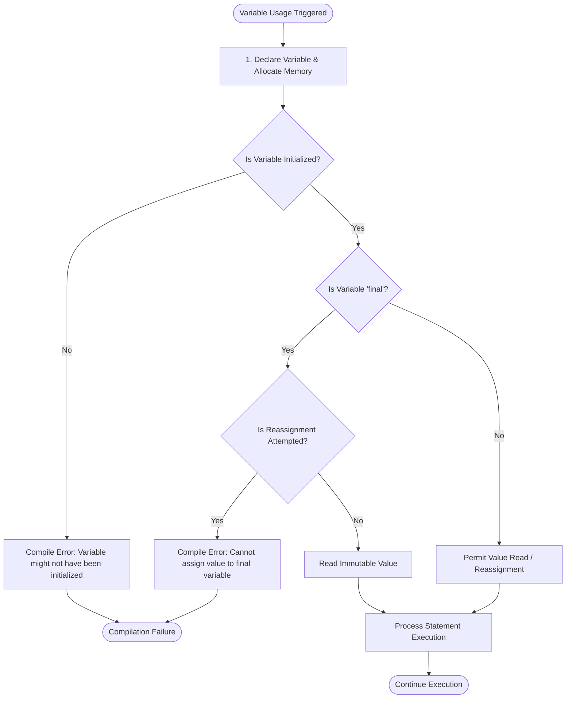

# Variables in Java

## Overview

In Java, a **variable** is a named location in memory used to store and manipulate data dynamically during execution. Java is a strongly typed language, meaning every variable must be declared with a explicit data type before it can be used. Variables serve as fundamental building blocks for state management, data processing, and object behavior across Java applications.

This guide covers:

- **Variable declaration & initialization** - syntax, storage rules, and assignment mechanics
- **Java data types & memory storage** - primitive types vs. reference variable references
- **Naming conventions & identifiers** - `camelCase` identifiers, validity rules, and constant naming
- **Immutability with `final`** - defining compile-time and runtime constants
- **String concatenation logic** - operator precedence, left-to-right evaluation, and mixing arithmetic
- **Common mistakes & traceback analysis** - resolving uninitialized variables, final reassignment, and naming bugs

---

## Table of Contents

1. [Variable Concept and Syntax](#variable-concept-and-syntax)
2. [Java Variable Declarations and Assignment](#java-variable-declarations-and-assignment)
3. [Identifiers and Naming Conventions](#identifiers-and-naming-conventions)
4. [Immutability with final Keyword](#immutability-with-final-keyword)
5. [String Concatenation and Evaluation Rules](#string-concatenation-and-evaluation-rules)
6. [Variable Allocation Flowchart](#variable-allocation-flowchart)
7. [Pure Java Code Examples](#pure-java-code-examples)
   * [Example 1: Variable Declaration, Initialization, and Reassignment](#example-1-variable-declaration-initialization-and-reassignment)
   * [Example 2: String Concatenation vs. Arithmetic Evaluation](#example-2-string-concatenation-vs-arithmetic-evaluation)
   * [Example 3: Constants and Real-World Domain Model](#example-3-constants-and-real-world-domain-model)
8. [Common Mistakes and Errors](#common-mistakes-and-errors)
9. [Exercises](#exercises)
10. [Quick Reference](#quick-reference)
11. [Related Topics](#related-topics)
12. [Why This Matters](#why-this-matters)
13. [Additional Resources](#additional-resources)

---

## Variable Concept and Syntax

### What is a Variable?

A variable acts as a labeled memory container for holding data values. When a variable is declared, the Java Virtual Machine (JVM) allocates memory based on the specified data type.

Every variable in Java consists of three mandatory attributes:
1. **Data Type:** Specifies the nature and size of the value stored (e.g., `int`, `double`, `String`).
2. **Identifier (Name):** A unique identifier used to reference the stored memory location.
3. **Value:** The actual data assigned to the memory location.

### Syntax

```java
// Declaration syntax
dataType variableName;

// Initialization syntax
variableName = value;

// Combined declaration and initialization
dataType variableName = value;
```

---

## Java Variable Declarations and Assignment

### Data Type Overview

Java variables fall into two major categories: **Primitives** (which store raw values directly on the stack) and **Reference Types** (which hold memory addresses pointing to objects on the heap).

```java
String name = "John";      // Reference type (stores String object pointer)
int age = 25;              // Primitive integer (32-bit whole number)
float price = 19.99f;      // Primitive floating-point (32-bit decimal)
char grade = 'A';          // Primitive character (16-bit Unicode)
boolean isStudent = true;  // Primitive boolean (true / false)
```

### Declaration vs. Reassignment

Variables can be declared first and populated later, or reassigned multiple times throughout execution—provided they are not marked immutable with `final`.

```java
// Declare first, assign later
int score;
score = 90;

// Reassignment
score = 95; // Previous value 90 is overwritten with 95
```

### Multiple Variable Declarations

Java allows declaring multiple variables of the same type within a single statement:

```java
// Declaring and initializing multiple variables in one line
int x = 5, y = 6, z = 50;

// Chained assignment of a uniform value
int a, b, c;
a = b = c = 100;
```

---

## Identifiers and Naming Conventions

### Identifier Rules

An **identifier** is the name assigned to a variable, method, class, or package. Java enforces strict rules regarding valid identifier construction:

* Must begin with a letter (`a-z`, `A-Z`), currency symbol (`$`), or underscore (`_`).
* Subsequent characters can include digits (`0-9`), letters, `$`, or `_`.
* Cannot start with a digit.
* Cannot contain whitespace or special characters (`@`, `#`, `-`, `%`).
* Cannot use reserved Java keywords (e.g., `int`, `class`, `public`, `return`).
* Identifiers are strictly **case-sensitive** (`age` and `Age` are distinct variables).

### Standard Naming Conventions

* **Variables & Methods (`camelCase`):** Start with a lowercase letter, capitalizing the first letter of each subsequent word (e.g., `studentAge`, `accountBalance`).
* **Constants (`UPPER_SNAKE_CASE`):** All letters capitalized with words separated by underscores (e.g., `MAX_RETRY_COUNT`, `PI`).
* **Classes (`PascalCase`):** Capitalize the first letter of every word (e.g., `StudentRecord`).

---

## Immutability with final Keyword

The `final` modifier declares a variable as **read-only** or immutable. Once a `final` variable is assigned a value, it can never be reassigned.

```java
final double PI = 3.14159;
final int MAX_USERS = 100;
```

Attempting to reassign a `final` variable causes a compilation failure:

```java
final int DAYS_IN_WEEK = 7;
DAYS_IN_WEEK = 8; // Compilation Error!
```

---

## String Concatenation and Evaluation Rules

The addition operator (`+`) is overloaded in Java. When applied to numerical operands, it performs arithmetic addition. When at least one operand is a `String`, it converts both operands into text and performs **String concatenation**.

### Left-to-Right Evaluation Precedence

Java evaluates expressions containing `+` operators sequentially from left to right:

```java
int x = 5;
int y = 6;

// Left-to-right evaluation converts x and y into text sequentially
System.out.println("The sum is " + x + y); // Prints: "The sum is 56"

// Parentheses override default left-to-right precedence
System.out.println("The sum is " + (x + y)); // Prints: "The sum is 11"
```

---

## Variable Allocation Flowchart

The following diagram illustrates how the JVM processes variable declaration, initialization checks, `final` immutability validation, and memory operations during program execution:



---

## Pure Java Code Examples

### Example 1: Variable Declaration, Initialization, and Reassignment

Demonstrates primitive variable creation, value reassignment, and multiple inline declarations.

```java
public class VariableLifecycleDemo {
    public static void main(String[] args) {
        // Declaration and initialization
        int currentScore = 50;
        System.out.println("Initial Score: " + currentScore);

        // Reassigning variable value
        currentScore = 75;
        System.out.println("Updated Score: " + currentScore);

        // Multiple inline declarations
        int length = 10, width = 5, area;
        area = length * width;
        System.out.println("Calculated Area: " + area);
    }
}
```

#### Output

```text
Initial Score: 50
Updated Score: 75
Calculated Area: 50
```

### Explanation

* `currentScore` is initially stored as `50` on the stack and later overwritten with `75`.
* Variables `length`, `width`, and `area` are declared simultaneously; `area` is computed using arithmetic expression `length * width`.

---

### Example 2: String Concatenation vs. Arithmetic Evaluation

Demonstrates operator precedence and how parentheses enforce arithmetic addition over text concatenation.

```java
public class ConcatenationDemo {
    public static void main(String[] args) {
        int valA = 10;
        int valB = 20;

        // Without grouping parentheses (evaluated left-to-right as Strings)
        System.out.println("Concat Output: " + valA + valB);

        // With explicit grouping parentheses (arithmetic evaluated first)
        System.out.println("Arithmetic Output: " + (valA + valB));

        // Leading arithmetic evaluation before String contactination
        System.out.println(valA + valB + " is the combined total");
    }
}
```

#### Output

```text
Concat Output: 1020
Arithmetic Output: 30
30 is the combined total
```

### Explanation

* `"Concat Output: " + valA + valB` evaluates `"Concat Output: 10"` first, then appends `20`, resulting in `"Concat Output: 1020"`.
* Explicit grouping `(valA + valB)` forces arithmetic evaluation first ($10 + 20 = 30$) before appending to the string prefix.
* `valA + valB + " is..."` evaluates `10 + 20` numerically first ($30$) because no `String` operand is encountered until after the first addition.

---

### Example 3: Constants and Real-World Domain Model

Demonstrates the use of `final` constants alongside standard dynamic variables in a business entity context.

```java
public class StudentRecord {
    // Constant fields (Immutable domain attributes)
    public static final String UNIVERSITY_NAME = "BUBT";
    public static final double GPA_SCALE = 4.0;

    public static void main(String[] args) {
        // Dynamic instance variables
        String studentName = "Alice Johnson";
        int completedCredits = 45;
        double currentGpa = 3.85;
        boolean isActive = true;

        System.out.println("--- Student Profile ---");
        System.out.println("University: " + UNIVERSITY_NAME);
        System.out.println("Name: " + studentName);
        System.out.println("Credits Completed: " + completedCredits);
        System.out.println("GPA: " + currentGpa + " / " + GPA_SCALE);
        System.out.println("Active Status: " + isActive);
    }
}
```

#### Output

```text
--- Student Profile ---
University: BUBT
Name: Alice Johnson
Credits Completed: 45
GPA: 3.85 / 4.0
Active Status: true
```

### Explanation

* `UNIVERSITY_NAME` and `GPA_SCALE` use `final` to ensure values remain immutable across application lifecycle.
* Primitive values (`completedCredits`, `currentGpa`, `isActive`) store domain state and can be modified as needed.

---

## Common Mistakes and Errors

### Mistake 1: Reassigning a final Variable

Attempting to change the value of an immutable `final` variable triggers a compilation error.

```java
public class FinalReassignmentBug {
    public static void main(String[] args) {
        final int MAX_USERS = 100;
        MAX_USERS = 150; // Compilation Error!
    }
}
```

### Traceback Error Analysis

```text
FinalReassignmentBug.java:4: error: cannot assign a value to final variable MAX_USERS
        MAX_USERS = 150;
        ^
1 error
```

* **File and Line Number:** `FinalReassignmentBug.java:4`
* **Root Cause:** A variable declared with `final` is read-only after initialization.
* **Resolution:** Remove the reassignment statement or remove the `final` keyword if the variable must remain dynamic.

---

### Mistake 2: Accessing Uninitialized Local Variables

Local variables declared within a method must be initialized before they are read.

```java
public class UninitializedVariableBug {
    public static void main(String[] args) {
        int count;
        System.out.println(count); // Compilation Error!
    }
}
```

### Traceback Error Analysis

```text
UninitializedVariableBug.java:4: error: variable count might not have been initialized
        System.out.println(count);
                           ^
1 error
```

* **File and Line Number:** `UninitializedVariableBug.java:4`
* **Root Cause:** Java does not assign default values to local variables declared inside methods.
* **Resolution:** Assign an initial value at declaration: `int count = 0;`.

---

### Mistake 3: Invalid Identifier Construction

Starting a variable name with a numerical digit violates Java identifier grammar rules.

```java
public class IdentifierBug {
    public static void main(String[] args) {
        int 2ndNumber = 50; // Compilation Error!
    }
}
```

### Traceback Error Analysis

```text
IdentifierBug.java:3: error: not a statement
        int 2ndNumber = 50;
            ^
IdentifierBug.java:3: error: ';' expected
        int 2ndNumber = 50;
             ^
2 errors
```

* **File and Line Number:** `IdentifierBug.java:3`
* **Root Cause:** Variable identifiers cannot begin with digits (`0-9`).
* **Resolution:** Rename the identifier using standard `camelCase`: `int secondNumber = 50;`.

---

## Exercises

### Exercise 01: Student Profile Declaration

Write a Java program that declares an `int` for student age, a `String` for student name, and a `boolean` for enrollment status. Print all three variables using descriptive labels.

* **Solution:** [Exercise 01: Student Profile Declaration](https://www.google.com/search?q=labs/exercise-01.student_profile_declaration.java)

### Exercise 02: Full Name Generator

Declare two `String` variables (`firstName` and `lastName`). Construct a third `fullName` variable that concatenates both variables separated by a space, and print the result.

* **Solution:** [Exercise 02: Full Name Generator](https://www.google.com/search?q=labs/exercise-02.full_name_generator.java)

### Exercise 03: Circle Metrics Calculator

Write a Java program using a `final double PI = 3.14159;` constant and a dynamic `double radius = 7.5;` variable. Calculate and print the circumference ($2 \times \pi \times r$) and area ($\pi \times r^2$).

* **Solution:** [Exercise 03: Circle Metrics Calculator](https://www.google.com/search?q=labs/exercise-03.circle_metrics_calculator.java)

---

## Quick Reference

| Concept | Syntax / Pattern | Description |
| --- | --- | --- |
| **Declaration** | `dataType varName;` | Allocates stack reference without value initialization |
| **Initialization** | `dataType varName = value;` | Declares and assigns an initial value to memory |
| **Reassignment** | `varName = newValue;` | Overwrites existing value with a new value |
| **Constant** | `final dataType CONSTANT_NAME = value;` | Declares immutable read-only variable |
| **String Concatenation** | `"Text " + varName` | Converts operand to `String` and appends text |
| **Grouping Addition** | `"Sum: " + (a + b)` | Enforces numerical addition before string concatenation |
| **Multiple Inline** | `int a = 1, b = 2, c = 3;` | Declares multiple variables of uniform type in one line |

---

## Related Topics

* [Basic Syntax](../01_basic_syntax/basic_syntax.md)
* [Data Types](../03_data_types/data_types.md)
* [Assignment Operators](../04_operators/assignment_operators/assignment_operators.md)

---

## Why This Matters

Variables form the foundation of state management in software applications. Correct variable declarations, understanding primitive memory versus object references, enforcing immutability with `final`, and maintaining clear naming conventions directly impact application memory management, code maintainability, and bug prevention.

---

## Additional Resources

* [GeeksforGeeks: Java Variables](https://www.geeksforgeeks.org/variables-in-java/)

---

## Key Takeaways

* Java is strongly typed; every variable requires a declared data type before use.
* Local variables must be initialized prior to reading or evaluating their value.
* Mark immutable variables using the `final` keyword and `UPPER_SNAKE_CASE` naming conventions.
* Enclose numerical additions in parentheses `(a + b)` when concatenating with text to ensure correct arithmetic precedence.
* Identifiers must follow case-sensitive rules and cannot start with numerical digits or match reserved keywords.

---

*Last Modified : October 26, 2026*
