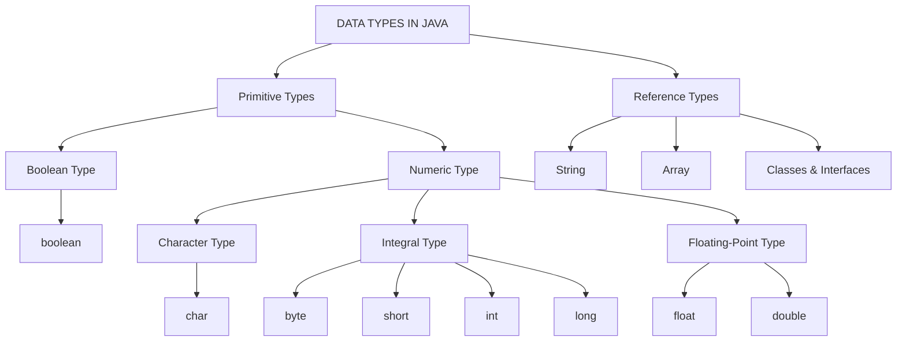
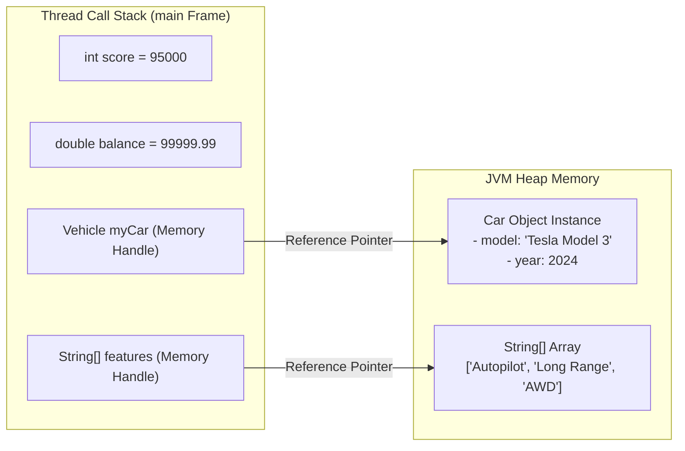

# Data Types in Java

## Overview

Java data types specify the nature, memory footprint, range, and allowable operations for variables. As a strongly, statically typed language, Java requires every variable to be declared with an explicit type at compile time to ensure type safety, optimize JVM execution, and prevent runtime memory errors.

This guide covers:

* **Type Hierarchy** - Visualizing Java's type taxonomy using Mermaid diagrams
* **Primitive Data Types** - Detailed breakdown of Java's 8 built-in types
* **Reference Data Types** - Objects, Strings, Arrays, and Interfaces
* **Memory Mechanics** - Stack (primitive) vs. Heap (reference) memory layout via Mermaid
* **Common Pitfalls** - Floating-point precision loss, integer overflow, and NPEs
* **Technical Interview Q&A** - Memory alignment and Integer Cache mechanics
* **Exercises & Solutions** - Production-ready, executable Java code challenges

---

## Table of Contents

1. [Data Types Hierarchy](https://www.google.com/search?q=%23data-types-hierarchy)
2. [Primitive Data Types](https://www.google.com/search?q=%23primitive-data-types)
3. [Non-Primitive (Reference) Data Types](https://www.google.com/search?q=%23non-primitive-reference-data-types)
4. [Memory Allocation: Stack vs. Heap](https://www.google.com/search?q=%23memory-allocation-stack-vs-heap)
5. [Common Mistakes and Code Smells](https://www.google.com/search?q=%23common-mistakes-and-code-smells)
6. [Technical Interview Questions & Answers](https://www.google.com/search?q=%23technical-interview-questions--answers)
7. [Exercises and Complete Solutions](https://www.google.com/search?q=%23exercises-and-complete-solutions)
8. [Quick Reference](https://www.google.com/search?q=%23quick-reference)
9. [Related Topics](https://www.google.com/search?q=%23related-topics)
10. [Why This Matters](https://www.google.com/search?q=%23why-this-matters)
11. [Additional Resources](https://www.google.com/search?q=%23additional-resources)

---

## Data Types Hierarchy

Java divides its type system into two primary categories: **Primitive Types** (raw values) and **Reference Types** (pointers to memory objects on the heap).



---

## Primitive Data Types

Primitive types are predefined by Java and hold raw values directly in memory. They are allocated on the Stack or inline within object fields and cannot be `null`.

| Type | Size | Default | Range / Value | Typical Use Case |
| --- | --- | --- | --- | --- |
| `boolean` | 1/8 bit* | `false` | `true` or `false` | Flag evaluation, logical branching |
| `byte` | 1 byte | `0` | $[-128, 127]$ | Stream processing, raw binary I/O |
| `short` | 2 bytes | `0` | $[-32768, 32767]$ | Large numeric arrays in limited memory |
| `int` | 4 bytes | `0` | $[-2147483648, 2147483647]$ | Default integer choice, loop counters |
| `long` | 8 bytes | `0L` | $[-2^{63}, 2^{63}-1]$ | Timestamps, database primary keys |
| `float` | 4 bytes | `0.0f` | IEEE 754 floating point | Graphics, fast scientific approximations |
| `double` | 8 bytes | `0.0d` | IEEE 754 double precision | Default floating point choice |
| `char` | 2 bytes | `'\u0000'` | $[0, 65535]$ (Unsigned UTF-16) | Single Unicode character |

**Note: `boolean` size is not JVM-specified; standalone booleans take 4 bytes (int stack slot), arrays take 1 byte per element.*

### Primitive Implementation Example

```java
public class PrimitiveTypesDemo {
    public static void main(String[] args) {
        boolean isActive = true;
        byte level = 5;
        short rank = 1200;
        int score = 95000;
        long timestamp = 1711234567890L;
        float rate = 4.5f;
        double balance = 99999.99;
        char grade = 'A';

        System.out.println("User Rank: " + rank + " | Grade: " + grade);
        System.out.println("Balance: $" + balance + " | Active: " + isActive);
    }
}

```

#### Output

```text
User Rank: 1200 | Grade: A
Balance: $99999.99 | Active: true

```

---

## Non-Primitive (Reference) Data Types

Reference types store memory addresses (pointers) targeting object instances allocated on the Heap. They derive from `java.lang.Object` and default to `null`.

### Primary Reference Types

1. **String:** Immutable character sequence (`java.lang.String`).
2. **Class:** Custom user-defined structural blueprints containing fields and methods.
3. **Interface:** Abstract structural contracts defining behaviors.
4. **Array:** Fixed-capacity, indexed container of homogenous elements.

### Reference Types Implementation Example

```java
interface Vehicle {
    void drive();
}

class Car implements Vehicle {
    String model;
    int year;

    Car(String model, int year) {
        this.model = model;
        this.year = year;
    }

    @Override
    public void drive() {
        System.out.println("Driving " + year + " " + model);
    }
}

public class ReferenceTypesDemo {
    public static void main(String[] args) {
        // String and Class Instance
        Vehicle myCar = new Car("Tesla Model 3", 2024);
        myCar.drive();

        // Array Reference
        String[] features = {"Autopilot", "Long Range", "AWD"};
        System.out.println("Primary Feature: " + features[0]);
    }
}

```

#### Output

```text
Driving 2024 Tesla Model 3
Primary Feature: Autopilot

```

---

## Memory Allocation: Stack vs. Heap

The JVM handles primitives and reference objects using two distinct memory structures:



* **Stack:** Stores primitive local variables and object reference pointers. Memory is released immediately when method frames finish execution.
* **Heap:** Stores instantiated objects (`new`) and array structures. Reclaimed automatically by Garbage Collection (GC).

---

## Common Mistakes and Code Smells

### 1. Floating-Point Precision Loss in Financial Calculations

`float` and `double` use IEEE 754 binary fractions, making exact base-10 representations impossible.

```java
// WRONG: Prints 0.30000000000000004
System.out.println(0.1 + 0.2);

// CORRECT: Use BigDecimal for exact financial calculations
BigDecimal b1 = new BigDecimal("0.1");
BigDecimal b2 = new BigDecimal("0.2");
System.out.println(b1.add(b2)); // Prints 0.3

```

### 2. Silent Integer Overflow

Primitive integer operations wrap around standard Two's Complement limits without throwing runtime errors.

```java
int max = Integer.MAX_VALUE; // 2147483647
int overflow = max + 1; // Wraps to -2147483648

// SAFEGUARD: Use Math.addExact() to throw ArithmeticException on overflow
int safeSum = Math.addExact(max, 1);

```

### 3. Auto-Unboxing NullPointerException

Unboxing a wrapper object (`Integer`, `Double`) containing a `null` reference causes an NPE.

```java
Integer count = null;
int val = count; // Throws NullPointerException

```

---

## Technical Interview Questions & Answers

### Q1: What is the difference between Primitive types and Wrapper classes?

**Answer:**
Primitives (`int`, `char`) store raw binary values on the Stack, take less memory, and cannot be `null`. Wrapper classes (`Integer`, `Character`) are object types wrapping primitives on the Heap, allowing participation in Java Collections (`List<Integer>`), generics, and utility method processing, but incur memory overhead and auto-unboxing performance costs.

### Q2: How does the Java Integer Cache work?

**Answer:**
Java caches `Integer` object instances for values between `-128` and `127`. Auto-boxing literals within this range (`Integer a = 100; Integer b = 100;`) returns identical cached objects (`a == b` evaluates to `true`). Values outside this range instantiate new Heap objects (`a == b` evaluates to `false`). Always use `.equals()` to compare wrapper object values.

---

## Exercises and Complete Solutions

### Exercise 1: Safe Financial Calculation Guard

```java
import java.math.BigDecimal;

public class FinancialGuard {
    public static void main(String[] args) {
        double itemPrice = 19.99;
        int quantity = 3;
        double rawTotal = itemPrice * quantity;

        BigDecimal precisePrice = new BigDecimal("19.99");
        BigDecimal preciseTotal = precisePrice.multiply(new BigDecimal(quantity));

        System.out.println("Raw Double Calculation  : " + rawTotal);
        System.out.println("Precise BigDecimal Total: $" + preciseTotal);
    }
}

```

#### Output

```text
Raw Double Calculation  : 59.970000000000006
Precise BigDecimal Total: $59.97

```

---

## Quick Reference

| Type | Classification | Size | Memory Location | Nullable |
| --- | --- | --- | --- | --- |
| `boolean`, `byte`, `short`, `int`, `long`, `float`, `double`, `char` | Primitive | Fixed (1-8 bytes) | Stack / Object Frame | No |
| `String`, `Array`, `Class`, `Interface` | Reference | Pointer (4-8 bytes) | Heap (Pointer on Stack) | Yes |

---

## Related Topics

* [Java Variables and Variable Scope](variables.md)
* [Java Type Casting and Type Promotion](https://www.google.com/search?q=type_casting.md)
* [Java Wrapper Classes and Autoboxing](https://www.google.com/search?q=wrapper_classes.md)

---

## Why This Matters

Selecting appropriate data types directly influences execution speed, memory alignment, and Garbage Collection overhead. Primitive types maximize memory locality and CPU throughput, while reference types provide structural abstraction. Avoiding floating-point errors and handling overflow correctly is essential for enterprise-grade backend stability.

---

## Additional Resources

* [Oracle Java Documentation: Primitive Data Types](https://docs.oracle.com/javase/tutorial/java/nutsandbolts/datatypes.html)
* [Java Language Specification: Types, Values, and Variables (JLS §4)](https://docs.oracle.com/javase/specs/jls/se17/html/jls-4.html)

---

*Last Updated: October 27, 2026*

---

## Key Takeaways

* Java features **8 primitive types** for raw value storage and **reference types** for heap object pointers.
* Primitives live on the **Stack**; object instances reside on the **Heap**.
* Never use `float` or `double` for currency—always use `BigDecimal`.
* Integer operations wrap around silently on overflow unless checked with `Math.addExact()`.
* Reference types default to `null`; unboxing `null` wrapper references throws a `NullPointerException`.
