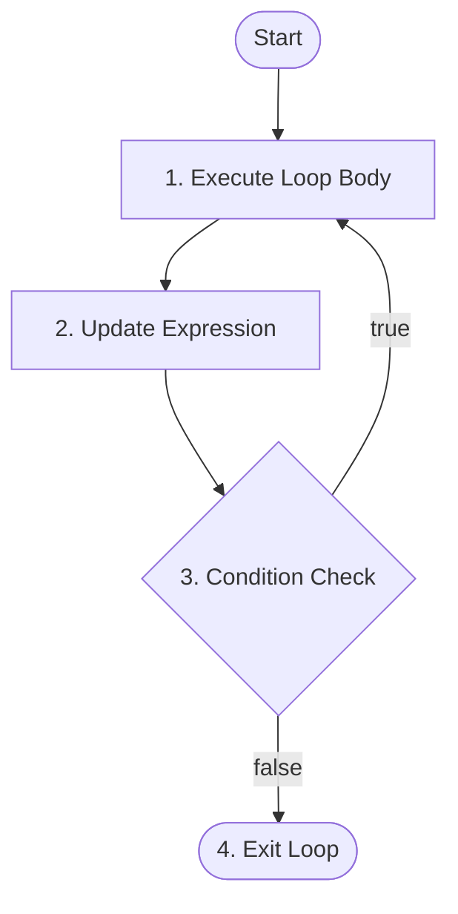

# do-while Loops in Java

## Overview

In Java programming language, control flow statements allow you to execute code blocks repeatedly based on a condition. The `do-while` loop is an **exit-controlled loop**, meaning the condition is evaluated at the end of the loop body rather than at the beginning. As a result, a `do-while` loop is guaranteed to execute its code block **at least once**, regardless of whether the condition initially evaluates to `true` or `false`.

This guide covers:

- **Standard `do-while` loop syntax** - guaranteed post-test execution mechanics
- **`do-while` vs. `while` loop behavior** - key execution timing and behavioral differences
- **Nested `do-while` loops** - multi-dimensional execution patterns
- **Common mistakes and interview traps** - scope errors in conditions, missing semicolons, and logic traps

---

## Table of Contents

1. [Standard do-while Loop Syntax](#standard-do-while-loop-syntax)
2. [do-while vs. while Loop Comparison](#do-while-vs-while-loop-comparison)
3. [Nested do-while Loops](#nested-do-while-loops)
4. [Miscellaneous](#miscellaneous)
5. [Common Mistakes and Errors](#common-mistakes-and-errors)
6. [Exercises](#exercises)
7. [Quick Reference](#quick-reference)
8. [Related Topics](#related-topics)
9. [Why This Matters](#why-this-matters)
10. [Additional Resources](#additional-resources)

---

## Standard do-while Loop Syntax

### What is a do-while Loop?

A `do-while` loop executes a block of statements first before evaluating a boolean condition. If the condition evaluates to `true`, the loop repeats. If the condition evaluates to `false`, execution exits the loop and proceeds to the next statement.

### Syntax

```java
do {
    // loop body
    // update statement
} while (condition); // Semicolon is mandatory!
```

### Flowchart for `do-while` Loop in Java



### How It Works (Execution Steps)

1. **Loop Body Execution:** The statements inside the `do` block execute unconditionally during the first pass.
2. **Update:** Variables involved in the termination condition are updated.
3. **Condition Check:** The boolean condition inside `while(...)` is evaluated after the body finishes executing.
4. **Repeat:** If the condition is `true`, control jumps back to Step 1.
5. **Exit:** If the condition is `false`, control exits the loop immediately.

---

### Implementation For Increment Update

```java
public class Main {
    public static void main(String[] args) {
        int i = 1; // Initialization

        // Syntax: do { ... } while (condition);
        do {
            System.out.println("Iteration count: " + i);
            i++; // Increment update
        } while (i <= 5);

        System.out.println("Loop has ended.");
    }
}
```

### Output

```text
Iteration count: 1
Iteration count: 2
Iteration count: 3
Iteration count: 4
Iteration count: 5
Loop has ended.
```

### Explanation

- Variable `i` is initialized to 1.
- The `do` block prints the iteration count and increments `i` to 2.
- The `while (i <= 5)` condition tests `2 <= 5` (`true`), triggering the next pass.
- When `i` reaches 6, `6 <= 5` evaluates to `false`, terminating the loop.

---

### Implementation For Decrement Update

```java
public class Main {
    public static void main(String[] args) {
        int i = 5; // Initialization

        // Syntax: do { ... } while (condition);
        do {
            System.out.println("Iteration count: " + i);
            i--; // Decrement update
        } while (i >= 1);

        System.out.println("Loop has ended.");
    }
}
```

### Output

```text
Iteration count: 5
Iteration count: 4
Iteration count: 3
Iteration count: 2
Iteration count: 1
Loop has ended.
```

### Explanation

- Variable `i` is initialized to 5.
- The body executes immediately, printing 5 and decrementing `i` to 4.
- Execution continues down to `i = 0`, at which point `0 >= 1` evaluates to `false`, ending the loop.

---

## do-while vs. while Loop Comparison

### Guaranteed At-Least-Once Execution

The defining technical difference between a `while` loop and a `do-while` loop is when the evaluation check occurs:

- **`while` loop (Entry-Controlled):** Checks condition **before** execution. If condition is `false` initially, execution count = 0.
- **`do-while` loop (Exit-Controlled):** Checks condition **after** execution. Even if condition is `false` initially, execution count = 1.

### Comparison Example

```java
public class Main {
    public static void main(String[] args) {
        int count = 10; // Value makes condition initial status false

        System.out.println("--- Testing standard while loop ---");
        while (count < 5) {
            System.out.println("This will never print.");
            count++;
        }

        System.out.println("--- Testing do-while loop ---");
        do {
            System.out.println("Executes once even though count (" + count + ") < 5 is false!");
            count++;
        } while (count < 5);
        
        System.out.println("Execution finished.");
    }
}
```

### Output

```text
--- Testing standard while loop ---
--- Testing do-while loop ---
Executes once even though count (10) < 5 is false!
Execution finished.
```

---

## Nested do-while Loops

### What are Nested do-while Loops?

A **nested `do-while` loop** places an inner `do-while` loop inside an outer `do-while` loop. For every single pass of the outer loop, the inner loop executes completely to completion.

### Syntax of Nested do-while Loop

```java
outer_initialization;
do {
    inner_initialization;
    do {
        // inner loop body
        inner_update;
    } while (inner_condition);
    
    // outer loop body
    outer_update;
} while (outer_condition);
```

### Implementation Example

```java
public class Main {
    public static void main(String[] args) {
        int i = 1;
        int rows = 3;
        int columns = 3;

        do {
            int j = 1; // Reset inner counter
            do {
                System.out.print("(" + i + "," + j + ") ");
                j++;
            } while (j <= columns);

            System.out.println(); // New line after each row
            i++;
        } while (i <= rows);
    }
}
```

### Output

```text
(1,1) (1,2) (1,3) 
(2,1) (2,2) (2,3) 
(3,1) (3,2) (3,3) 
```

---

## Miscellaneous

### Infinite do-while Loop in Java

An infinite `do-while` loop occurs when the condition checked in the `while` clause remains perpetually `true`.

```java
public class Main {
    public static void main(String[] args) {
        do {
            System.out.println("Infinite Loop!");
        } while (true);
    }
}
```

### Output

```text
Infinite Loop!
Infinite Loop!
Infinite Loop!
Infinite Loop!
Infinite Loop!
....
```

> **Note:** A **"Time Limit Exceeded"** error occurs on online judges or competitive programming platforms when an unintended infinite loop prevents program termination.

---

## Common Mistakes and Errors

### Mistake 1: Variable Scope Error in Condition (Interview Trap)

Declaring a loop control variable **inside** the `do` block renders it invisible to the `while(...)` condition test.

```java
// Incorrect: Variable 'i' declared inside block scope
do {
    int i = 1;
    System.out.println(i);
    i++;
} while (i <= 5); // Compilation Error: cannot find symbol 'i'
```

### Traceback Error Analysis

```text
Main.java:7: error: cannot find symbol
} while (i <= 5);
         ^
  symbol:   variable i
  location: class Main
1 error
```

- **Root Cause:** Block scope restricts variable `i` to the boundaries of `{ ... }`. The `while(i <= 5)` check takes place **outside** that scope.
- **Resolution:** Declare control variables **before** entering the `do` block:

```java
// Correct: Control variable declared outside loop block scope
int i = 1;
do {
    System.out.println(i);
    i++;
} while (i <= 5);
```

---

### Mistake 2: Missing Mandatory Semicolon After `while(...)`

Unlike `for` and `while` loops, the `do-while` construct **requires** a terminating semicolon `;` immediately following the condition expression.

```java
int i = 1;
// Incorrect: Missing trailing semicolon
do {
    System.out.println(i);
    i++;
} while (i <= 5)
```

### Traceback Error Analysis

```text
Main.java:7: error: ';' expected
} while (i <= 5)
                ^
1 error
```

- **Resolution:** Append a `;` right after the closing parenthesis of `while (condition);`.

---

### Mistake 3: Infinite Loops Due to Missing State Update

Omitting the state modification step causes the exit condition to evaluate identically on every pass.

```java
int i = 1;
// Incorrect: Missing increment step i++
do {
    System.out.println("Iteration: " + i);
} while (i <= 5); // i remains 1 forever
```

**Correction:** Always ensure state updates drive values toward loop termination:

```java
int i = 1;
do {
    System.out.println("Iteration: " + i);
    i++; // Correct update
} while (i <= 5);
```

---

## Exercises

File naming convention: Use PascalCase for Java class names (for example, `DoWhileLoopExercises.java`).

### Exercise 01: Factorial Calculation

Write a program that takes an integer variable `n` (e.g., $n = 5$) and calculates its factorial ($5! = 5 \times 4 \times 3 \times 2 \times 1 = 120$) using a `do-while` loop.

- **Solution:** [Exercise 01: Factorial Calculation](labs/exercise-01.factorial_calculation.java)

### Exercise 02: State Processing Simulation

Write a program that simulates processing state steps from $10$ down to $0$ using a `do-while` loop. The program should subtract $3$ during each cycle and terminate as soon as state drops to $0$ or lower.

* **Solution:** [Exercise 02: State Processing Simulation](labs/exercise-02.state_processing_simulation.java)

### Exercise 03: Sum Until Threshold Reached

Write a program that takes a starting value `number = 1` and uses a `do-while` loop to repeatedly add square values ($1^2 + 2^2 + 3^2 + \dots$) into a `sum` variable until `sum` exceeds $100$.

* **Solution:** [Exercise 03: Sum Until Threshold Reached](labs/exercise-03.sum_until_threshold_reached.java)

---

## Quick Reference

| Concept | Syntax / Pattern | Key Characteristic |
| --- | --- | --- |
| Standard `do-while` Loop | `do { ... } while (condition);` | Exit-controlled; guaranteed to execute **at least once** |
| Infinite `do-while` Loop | `do { ... } while (true);` | Runs indefinitely until terminated via `break` or exception |
| Syntax Requirement | `... while (condition);` | Requires mandatory trailing semicolon `;` after condition |

---

## Related Topics

- [for Loop](../for_loop/for_loop.md)
- [while Loop](../while_loop/while_loop.md)
- [break Statements](../../10_jump_statements/return_statement/break_statement.md)

---

## Why This Matters

`do-while` loops are essential in situations where an action **must** take place before evaluating a condition (such as state initializations, iterative convergence checks, menu render cycles, or attempt retries). Understanding `do-while` variable scoping is also a standard technical check in Java developer interviews.

---

## Additional Resources

- [GeeksforGeeks: Java do-while Loop with Examples](https://www.geeksforgeeks.org/java-do-while-loop-with-examples/)

---

## Key Takeaways

- `do-while` loops are **exit-controlled**, evaluating boolean conditions at the end of every pass.
- Loop body execution occurs **at least once** regardless of initial condition status.
- Variables referenced in `while (condition);` must be declared outside the `do { ... }` block to avoid scope compilation errors.
- Always append a semicolon `;` after the `while(condition)` expression.

---

*Last Modified : October 23, 2026*
