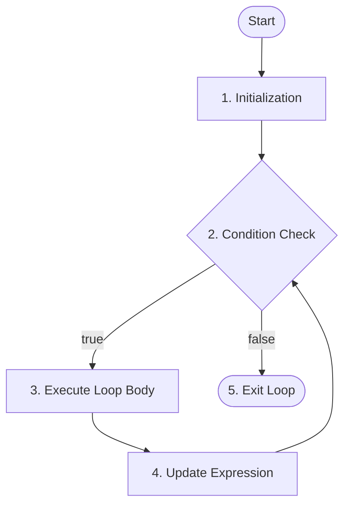

# for Loops in Java

## Overview

In Java, control flow statements allow you to execute code blocks repeatedly based on a condition. The `for` loop is one of the most frequently used looping constructs when you know in advance how many times a statement or block of statements should execute. Java provides both the standard indexed `for` loop and the enhanced `for` loop (for-each) for iterating over arrays and collections.

This guide covers:

* **Standard `for` loop** - iterating with initialization, condition, and update expressions
* **Enhanced `for` loop (for-each)** - simplifying array and collection iteration
* **Nested `for` loops** - handling multi-dimensional structures and patterns
* **Common mistakes and errors** - preventing infinite loops, off-by-one errors, and scope issues

---

## Table of Contents

1. [Standard For Loop Syntax](#standard-for-loop-syntax)
2. [Enhanced For Loop (For-Each)](#enhanced-for-loop-for-each)
3. [Nested For Loops](#nested-for-loops)
4. [Miscellaneous](#miscellaneous)
5. [Common Mistakes and Errors](#common-mistakes-and-errors)
6. [Exercises](#exercises)
7. [Quick Reference](#quick-reference)
8. [Related Topics](#related-topics)
9. [Why This Matters](#why-this-matters)
10. [Additional Resources](#additional-resources)

---

## Standard for Loop Syntax

### What is a for Loop?

A standard `for` loop provides a compact way to iterate over a range of values. It groups three key elements into a single header line: **initialization**, **boolean condition**, and **update expression**.

### Syntax

```java
for (initialization; condition; increment/decrement) {
    // loop body
}
```

### Flowchart for `for` Loop in Java



### How It Works (Execution Steps)

1. **Initialization:** Executed once when the loop starts.
2. **Condition:** Evaluated before every iteration.
3. **Loop Body Execution:** If the condition is `true`, the loop body executes.
4. **Update:** After execution, the update expression runs.
5. **Repeat:** Steps 2–4 repeat until the condition becomes `false`.
6. **Exit:** Control exits the loop once the condition fails (`false`).

---

### Implementation For Increment Update

```java
public class Main {
    public static void main(String[] args) {
        // Syntax: for (initialization; condition; increment update)
        for (int i = 1; i <= 5; i++) {
            System.out.println("Iteration count: " + i);
        }
        System.out.prinln("Loop has ended.");
    }
}
```

### Output

```text
Iteration count: 1
Iteration count: 2
Iteration count: 3
Iteration count: 4
Iteration count: 5
Loop has ended.
```

### Explanation
* The loop variable i starts from 1.
* The loop runs as long as i<=5.
* After each iteration, i is increased by 1.
* When the condition becomes false, the loop terminates.

---

### Implementation For Decrement Update

```java
public class Main{
    public static void main(String[] args){
        // Syntax: for (initialization; condition; decrement update)
        for(int i = 5; i >= 1; i--){
            System.out.println("Iteration count: " + i);
        }
        System.out.println("Loop has ended.");
    }
}
```

### Output
```text
Iteration count: 5
Iteration count: 4
Iteration count: 3
Iteration count: 2
Iteration count: 1
Loop has ended.
```

### Explanation
* The loop variable i starts from 5.
* The loop runs as long as `i>=1`.
* After each iteration, i is decreased by 1.
* When the condition becomes false, the loop terminates.

---

## Enhanced for Loop (for-each)

### What is an Enhanced for Loop?

Introduced in Java programming language, the **enhanced `for` loop** (often called the **for-each** loop) simplifies sequential traversal through arrays or `Iterable` objects without managing index counters.


### Implementation Example

```java
public class Main {
    public static void main(String[] args) {
        String[] languages = {"Java", "Python", "C++", "JavaScript"};

        // Iterating through an array using for-each
        for (String language : languages) {
            System.out.println("Language: " + langugage);
        }
    }
}
```

### Output

```text
Language: Java
Language: Python
Language: C++
Language: JavaScript
```

### When to Use for-each vs. Standard for Loop

* Use **Enhanced for Loop** when you need to read every element in sequential order without modifying the collection or needing index position logic.
* Use **Standard for Loop** when you need array index access, wish to modify array elements, or need to step through elements backwards or in non-sequential increments.

> **Note:** The enhanced `for` loop hides the index variable completely, preventing accidental index-out-of-bound exceptions during iteration.
>
> 

---

## Nested for Loops

### What are Nested For Loops?

A **nested `for` loop** occurs when one loop is defined inside another loop. The inner loop executes completely every single time the outer loop runs once.

### Syntax of Nested for loop
```java
for(initialization; condition;increment/decrement){
    for(initialization; condition;increment/decrement){
        // statement of inner loop
    }
    // statement of outer loop
}
```

### Implementation Example

```java
public class Main {
    public static void main(String[] args) {
        int rows = 3;
        int columns = 3;

        for (int i = 1; i <= rows; i++) {
            for (int j = 1; j <= columns; j++) {
                System.out.print("(" + i + "," + j + ") ");
            }
            System.out.println(); // New line after each row
        }
    }
}
```

### Output

```text
(1,1) (1,2) (1,3) 
(2,1) (2,2) (2,3) 
(3,1) (3,2) (3,3) 
```

---

## Miscellaneous

### Infinite for Loop in Java
An infinite for loop occurs when the loop condition never becomes `false`.

```java
public class Main {
    public static void main(String[] args) {
        for (;;) {
            System.out.println("Infinite Loop!");
        }
    }
}
```
### Output
```text
Infinite Loop!
Infinite Loop!
Infinite Loop!
Infinite Loop!
Infinite Loop!
....
```
> **Note:** A **"Time Limit Exceeded"** error occurs when a program runs longer than the time allocated for execution, due to infinite loops.
>
> 

## Common Mistakes and Errors

### Mistake 1: Infinite Loops Due to Incorrect Update

Forgetting to update the loop counter or updating it in the wrong direction causes an infinite loop.

```java
// Incorrect: Counter decreases while condition checks for <= 5
for (int i = 1; i <= 5; i--) {
    System.out.println(i);
}
```

**Correction:** Ensure the update step moves the loop counter toward terminating the condition:

```java
for (int i = 1; i <= 5; i++) {
    System.out.println(i);
}
```

### Mistake 2: Variable Scope Error

Attempting to access a loop variable outside the loop header where it was declared produces a compilation error.

```java
for (int i = 0; i < 5; i++) {
    // Variable i is scoped only inside this block
}
System.out.println(i); // Compilation Error!
```

### Traceback Error Analysis

```text
Main.java:7: error: cannot find symbol
        System.out.println(i);
                           ^
  symbol:   variable i
  location: class Main
```

* **File and Line Number:** Indicates exact source file and line location (`Main.java:7`).
* **Error Description:** States `cannot find symbol`, meaning the compiler does not recognize variable `i` in this scope.
* **Resolution:** Declare variable `i` outside the loop prior to execution if its value is required outside the loop block.

### Mistake 3: Off-by-One Error (ArrayIndexOutOfBoundsException)

Using `<=` instead of `<` when checking against array `.length` triggers an out-of-bounds error.

```java
int[] numbers = {10, 20, 30};
// Incorrect: Array indices are 0 to 2, but i reaches index 3
for (int i = 0; i <= numbers.length; i++) {
    System.out.println(numbers[i]);
}
```

### Mistake 4: Misplaced Semicolon Creating Empty Loop and Scope Error
Placing a semicolon`;` immediately after the `for` loop header terminates the loop statement prematurely. The loop becomes an isolated block where variable `i` is no longer in scope.
```java
// Incorrect: Semicolon creates an empty loop statement
for(int i = 0; i <= 5; i++){
    System.out.println(i); // Compilation Error: cannot find symbol 'i'
}
```
### Traceback Error Analysis
```text
System.out.println(i); // Compilation Error: cannot find symbol 'i'
                               ^
  symbol:   variable i
  location: class Main
1 error
```
* **Root Cause:** The trailing `;` ends the loop body immediately.
* **Scope Violation:** The block `{ System.out.println(i); }` is treated as independent code outside the `for` loop where `i` is undefined.

**Correction:** Remove the misplaced semicolon after the loop header:
```java
// Correct: Semicolon removed
for(int i = 0; i <= 5; i++){
    System.out.println(i);
}
```

---

## Exercises

File naming convention: Use PascalCase for Java class names (for example, `ForLoopExercises.java`).

### Exercise 01: Multiplication Table Generator

Write a program that takes an integer `num` and uses a `for` loop to print its multiplication table from 1 to 10.

### Exercise 02: Right-Angled Star Pyramid

Write a program that takes an integer `rows` (e.g., `rows = 5`) and uses nested `for` loops to print a right-angled star pyramid pattern:

```text
*
**
***
****
*****
```

### Exercise 03: Array Sum and Even Counter

Write a program that initializes an array of integers. Use an enhanced `for` loop to calculate both the **sum of all elements** and count how many **even numbers** exist in the array.

---

## Quick Reference

| Concept | Syntax / Pattern | Description | 
| ----- | ----- | ----- | 
| Standard For Loop | `for (int i = 0; i < n; i++) { ... }` | Executes a block a predictable number of times using an index counter | 
| Enhanced For Loop | `for (Type item : array) { ... }` | Cleanly iterates through all items in arrays/collections | 
| Infinite For Loop | `for (;;) { ... }` | Omits header arguments; runs indefinitely until broken | 
| Loop Exiting | `break;` | Terminates the innermost loop immediately | 
| Iteration Skipping | `continue;` | Skips remaining body code and triggers the update step | 

---

## Related Topics

* [while Loop](../while_loop/while_loop.md)
* [do while Loop](../do_while_loop/do_while_loop.md)
* [break Statements](../../10_jump_statements/break_statements/break_statements.md)

---

## Why This Matters

Mastering `for` loops is essential for basic logic execution, traversing arrays, and building complex algorithms in Java. Efficient iteration forms the foundation of data manipulation, search algorithms, and multi-dimensional structure processing in production-grade software development.

---

## Additional Resources

[GeeksforGeeks](https://www.geeksforgeeks.org/java/java-for-loop-with-examples/)

---

## Key Takeaways

* Standard `for` loops consolidate initialization, boolean check, and incremental updates in a single header line.
* Enhanced `for` loops (for-each) streamline sequential array/collection traversal while eliminating index management errors.
* Nested `for` loops enable execution over multi-dimensional data structures such as matrix grids and nested arrays.
* `break` exits the loop unconditionally, whereas `continue` bypasses the remaining loop body and triggers the update expression.
* Pay attention to array bounds (`< array.length`) to prevent `ArrayIndexOutOfBoundsException` at runtime.

---

*Last Modified : October 22, 2026*
