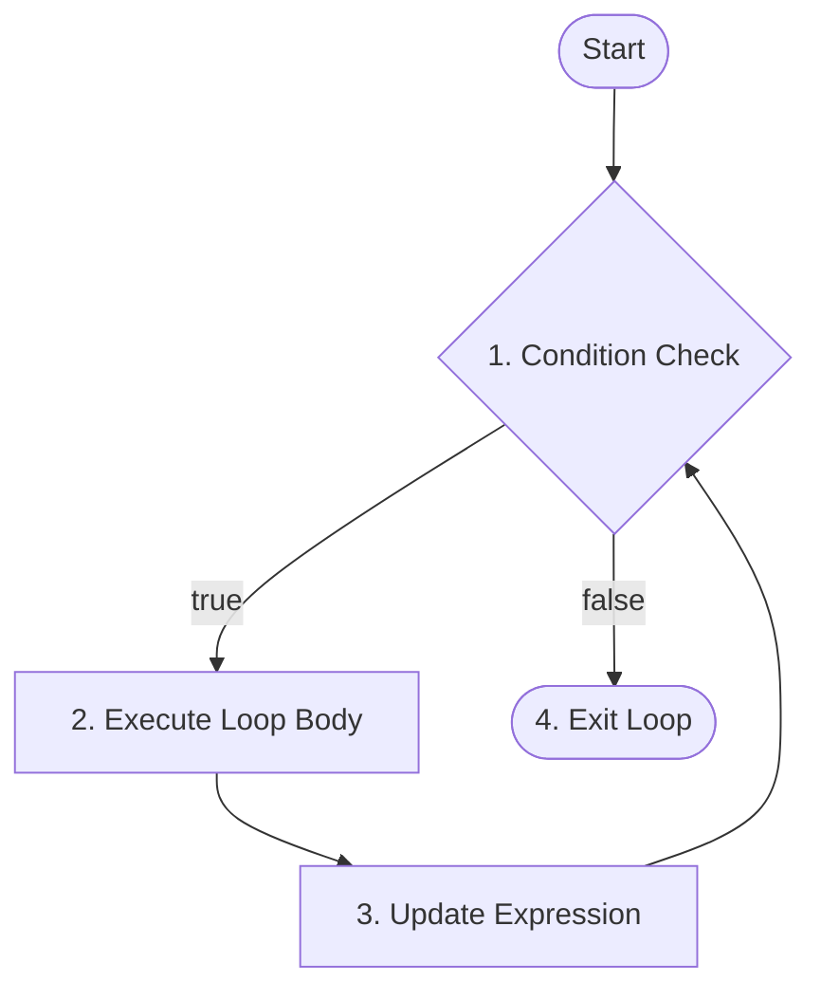

# while Loops in Java

## Overview

In Java programming language, control flow statements allow you to execute code blocks repeatedly based on a condition. The `while` loop is an entry-controlled loop used when the number of iterations is not known in advance and depends on a dynamic condition remaining `true`.

This guide covers:

- **Standard `while` loop** - iterating based on pre-test boolean condition evaluation
- **Sentinel-controlled `while` loop** - processing input until a specific sentinel value is encountered
- **Nested `while` loops** - handling multi-dimensional structures and nested repeating logic
- **Common mistakes and errors** - preventing infinite loops, off-by-one errors, missing updates, and misplaced semicolons

---

## Table of Contents

1. [Standard While Loop Syntax](#standard-while-loop-syntax)
2. [Flag-Controlled While Loop](#flag-controlled-while-loop)
3. [Nested While Loops](#nested-while-loops)
4. [Miscellaneous](#miscellaneous)
5. [Common Mistakes and Errors](#common-mistakes-and-errors)
6. [Exercises](#exercises)
7. [Quick Reference](#quick-reference)
8. [Related Topics](#related-topics)
9. [Why This Matters](#why-this-matters)
10. [Additional Resources](#additional-resources)

---

## Standard while Loop Syntax

### What is a while Loop?

A standard `while` loop evaluates a boolean expression before executing the loop body. If the condition evaluates to `true`, the statements inside the loop body execute. This process repeats until the condition evaluates to `false`.

### Syntax

```java
while (condition) {
    // loop body
    // update statement
}
```

### Flowchart for `while` Loop in Java



### How It Works (Execution Steps)

1. **Condition Check:** Evaluated before every iteration.
2. **Loop Body Execution:** If the condition is `true`, the loop body executes.
3. **Update:** Variables involved in the condition are modified inside the body.
4. **Repeat:** Steps 1–3 repeat until the condition evaluates to `false`.
5. **Exit:** Control exits the loop as soon as the condition fails (`false`).

---

### Implementation For Increment Update

```java
public class Main {
    public static void main(String[] args) {
        int i = 1; // Initialization
        
        // Syntax: while (condition)
        while (i <= 5) {
            System.out.println("Iteration count: " + i);
            i++; // Increment update
        }
        System.out.println("Loop has ended.");
    }
}
```

### Output

```text
Iteration count: 1
Iteration count: 2
Iteration count: 3
Iteration count: 4
Iteration count: 5
Loop has ended.
```

### Explanation
- The loop variable `i` is initialized to 1 before entering the loop.
- The loop condition checks whether `i <= 5`.
- After printing, `i` is incremented by 1 inside the loop body.
- When `i` becomes 6, the condition becomes false and the loop terminates.

---

### Implementation For Decrement Update

```java
public class Main {
    public static void main(String[] args) {
        int i = 5; // Initialization
        
        // Syntax: while (condition)
        while (i >= 1) {
            System.out.println("Iteration count: " + i);
            i--; // Decrement update
        }
        System.out.println("Loop has ended.");
    }
}
```

### Output

```text
Iteration count: 5
Iteration count: 4
Iteration count: 3
Iteration count: 2
Iteration count: 1
Loop has ended.
```

### Explanation
- The loop variable `i` is initialized to 5.
- The loop runs as long as `i >= 1`.
- After each iteration, `i` is decreased by 1.
- When `i` reaches 0, the condition becomes false and execution exits the loop.

---

## Flag-Controlled while Loop

### What is Flag-Controlled Loop?
A **flag-controlled `while` loop** uses a boolean variable (known as a **flag**) to control whether the loop continues executing. The flag starts with an initial boolean value (`true` or `false`) and is updated based on internal logic evaluated during loop execution.

### Implementation Example
```java
public class Main {
    public static void main(String[] args) {
        boolean searching = true;
        int number = 1;
        
        // Loop runs as long as the flag 'searching' remains true
        while (searching) {
            if (number % 7 == 0 && number % 5 == 0) {
                System.out.println("Found first number divisible by both 7 and 5: " + number);
                searching = false; // Flag updated to terminate loop
            }
            else{
                number++;
            }
        }
        System.out.println("Search Completed.");
    }
}
```

### Output
```text
Found first number divisible by both 7 and 5: 35
Search Completed.
```

### When to Use while Loop vs. Standard for Loop

- Use **`while` Loop** when the number of iterations is variable or dependent on user input, file reads, or state changes.
- Use **Standard `for` Loop** when you know the exact number of iterations upfront or need an explicit loop index counter.

> **Note:** Because a `while` loop tests its condition before executing the body, if the condition initially evaluates to `false`, the loop body will not execute at all (0 iterations).
>
> 

---

## Nested while Loops

### What are Nested While Loops?

A **nested `while` loop** consists of one `while` loop placed inside another `while` loop. For each single iteration of the outer loop, the inner loop executes completely from start to finish.

### Syntax of Nested while loop

```java
outer_initialization;
while (outer_condition) {
    inner_initialization;
    while (inner_condition) {
        // statement of inner loop
        inner_update;
    }
    // statement of outer loop
    outer_update;
}
```

### Implementation Example

```java
public class Main {
    public static void main(String[] args) {
        int i = 1;
        int rows = 3;
        int columns = 3;

        while (i <= rows) {
            int j = 1; // Reset inner counter for every outer iteration
            while (j <= columns) {
                System.out.print("(" + i + "," + j + ") ");
                j++;
            }
            System.out.println(); // New line after each row
            i++;
        }
    }
}
```

### Output

```text
(1,1) (1,2) (1,3) 
(2,1) (2,2) (2,3) 
(3,1) (3,2) (3,3) 
```

---

## Miscellaneous

### Infinite while Loop in Java

An infinite `while` loop occurs when the loop condition evaluates to `true` continuously and never becomes `false`.

```java
public class Main {
    public static void main(String[] args) {
        while (true) {
            System.out.println("Infinite while Loop!");
        }
    }
}
```

### Output

```text
Infinite while Loop!
Infinite while Loop!
Infinite while Loop!
Infinite while Loop!
Infinite while Loop!
....
```

> **Note:** A **"Time Limit Exceeded"** error occurs when a program runs longer than the time allocated for execution, due to infinite loops.
>
> 

---

## Common Mistakes and Errors

### Mistake 1: Infinite Loops Due to Missing or Incorrect Update

Forgetting to update the loop condition variable inside the loop body causes an infinite loop.

```java
int i = 1;
// Incorrect: Missing counter increment i++ inside the loop body
while (i <= 5) {
    System.out.println(i);
}
```

**Correction:** Always ensure the control variable is updated within the loop body toward terminating the condition:

```java
int i = 1;
while (i <= 5) {
    System.out.println(i);
    i++; // Correct update step added
}
```

### Mistake 2: Variable Scope and Uninitialized Variables

Attempting to use an uninitialized variable in the `while` condition produces a compilation error.

```java
int i;
// Incorrect: Variable 'i' might not have been initialized
while (i < 5) {
    System.out.println(i);
    i++;
}
```

### Traceback Error Analysis

```text
Main.java:5: error: variable i might not have been initialized
        while (i < 5) {
               ^
1 error
```

- **File and Line Number:** Indicates exact source file and line location (`Main.java:5`).
- **Error Description:** States `variable i might not have been initialized`, preventing compilation.
- **Resolution:** Explicitly initialize the control variable before the `while` statement header (e.g., `int i = 0;`).

### Mistake 3: Off-by-One Error (ArrayIndexOutOfBoundsException)

Using `<=` instead of `<` when traversing array bounds with a `while` loop causes an out-of-bounds error.

```java
int[] numbers = {10, 20, 30};
int index = 0;

// Incorrect: Array indices are 0 to 2, but index reaches 3
while (index <= numbers.length) {
    System.out.println(numbers[index]);
    index++;
}
```

### Mistake 4: Misplaced Semicolon Creating Empty Loop and Scope Error

Placing a semicolon `;` immediately after the `while` condition creates an empty loop statement that evaluates continuously without running the intended code block below it.

```java
int i = 0;
// Incorrect: Semicolon creates an empty infinite loop
while (i <= 5); {
    System.out.println(i);
    i++;
}
```

### Traceback Error Analysis

```text
Main.java:4: error: cannot find symbol
        System.out.println(i);
                           ^
  symbol:   variable i
  location: class Main
1 error
```

- **Root Cause:** The trailing `;` isolates the `while (i <= 5);` line. Since `i` is never incremented inside the empty loop body, it stays `0` forever, stalling execution.
- **Scope Violation:** If `i` is declared inside a limited block, isolating `{ ... }` below the loop header leads to scope bugs.

**Correction:** Remove the misplaced semicolon after the `while` condition:

```java
int i = 0;
// Correct: Semicolon removed
while (i <= 5) {
    System.out.println(i);
    i++;
}
```

---

## Exercises

File naming convention: Use PascalCase for Java class names (for example, `WhileLoopExercises.java`).

### Exercise 01: Reverse a Number

Write a program that takes an integer `num` and uses a `while` loop to compute and print its reversed value (e.g., `1234` becomes `4321`).

- **Solution:** [Exercise 01: Reverse a Number](labs/exercise-01.reverse_a_number.java)

### Exercise 02: Sum of Digits

Write a program that takes an integer `num` (e.g., `num = 54321`) and uses a `while` loop to calculate the sum of all its individual digits ($5 + 4 + 3 + 2 + 1 = 15$).

* **Solution:** [Exercise 02: Sum of Digits](labs/exercise-02.sum_of_digits.java)

### Exercise 03: GCD Calculator (Euclidean Algorithm)

Write a program that takes two integers `a` and `b` and uses a `while` loop to find their Greatest Common Divisor (GCD) using the Euclidean algorithm ($a \% b$).

* **Solution:** [Exercise 03: GCD Calculator](labs/exercise-03.gcd_calculator.java)

---

## Quick Reference

| Concept | Syntax / Pattern | Description |
| ----- | ----- | ----- |
| Standard While Loop | `while (condition) { ... }` | Executes code repeatedly as long as condition evaluates to `true` |
| Infinite While Loop | `while (true) { ... }` | Loops indefinitely until explicit break statement or exit condition |
| Sentinel Loop | `while (input != SENTINEL) { ... }` | Continues execution until user inputs a designated sentinel value |

---

## Related Topics

- [for Loop](../for_loop/for_loop.md)
- [do while Loop](../do_while_loop/do_while_loop.md)
- [break Statements](../../10_jump_statements/break_statement/break_statement.md)

---

## Why This Matters

Mastering `while` loops is critical for handling non-deterministic iterations where loop bounds are governed by runtime inputs, external files, stream processing, or logical state flags rather than fixed numerical ranges.

---

## Additional Resources

- [GeeksforGeeks](https://www.geeksforgeeks.org/java-while-loop-with-examples/)

---

## Key Takeaways

- `while` loops test conditions before executing the loop body (entry-controlled iteration).
- Always ensure state updates occur inside the loop body to avoid infinite execution.
- Sentinel values allow dynamic input-driven processing without knowing iteration counts upfront.

---

*Last Modified : October 23, 2026*
