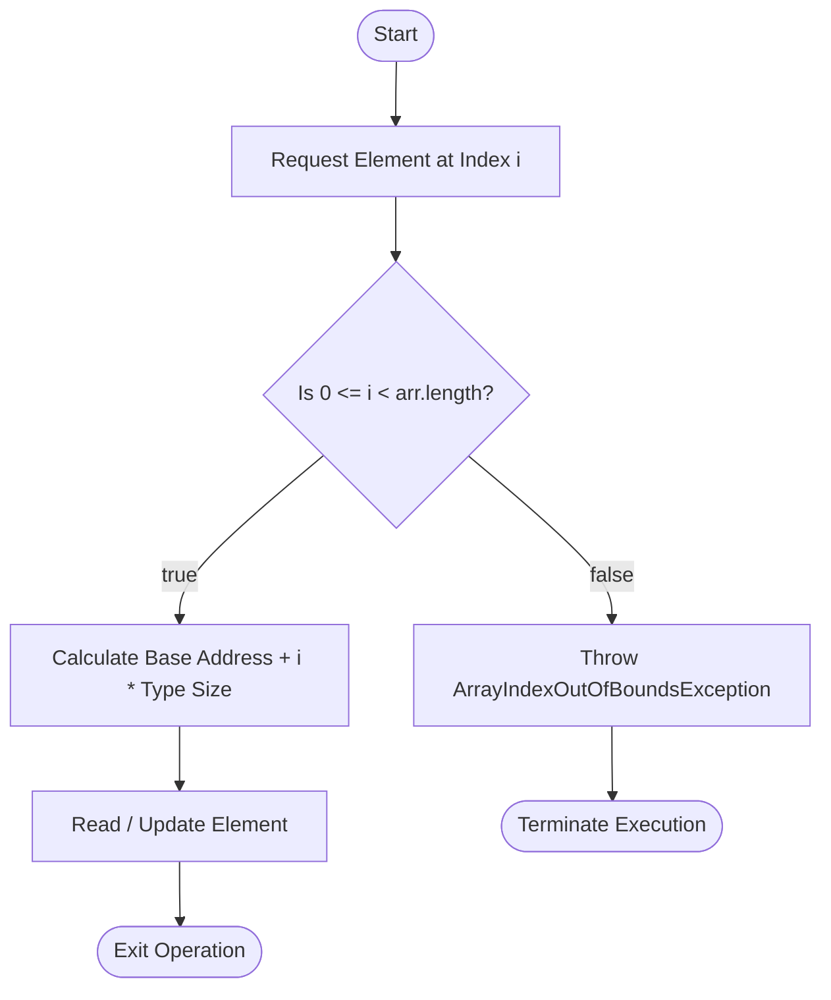

# Introduction to Array in Java

## Overview

In Java programming language, an **array** is a foundational linear data structure used to store a fixed-size sequence of elements of the same data type in contiguous memory locations. Arrays allow you to manage multiple related values under a single variable name and retrieve or modify them efficiently using zero-based indexing. Java supports arrays of primitive types (like `int`, `boolean`, `char`) as well as non-primitive reference types (like `String` or custom objects).

This guide covers:

- **Array declaration and initialization** - defining primitive, reference, and array literal constructs
- **Core array operations** - accessing elements, updating values, retrieving size, and traversing arrays
- **Arrays of objects** - managing custom class instances in sequential reference slots
- **Passing and returning arrays** - passing arrays to methods and returning arrays from functions
- **Common mistakes and errors** - resolving index out-of-bounds, null pointer traps, and length method errors

---

## Table of Contents

1. [Array Declaration and Initialization](#array-declaration-and-initialization)
2. [Memory Architecture & Indexing](#memory-architecture--indexing)
3. [Flowchart for Array Access in Java](#flowchart-for-array-access-in-java)
4. [Pure Java Code Examples](#pure-java-code-examples)
   * [Example 1: Primitive & Reference Arrays](#example-1-primitive--reference-arrays)
   * [Example 2: Core Array Operations](#example-2-core-array-operations)
   * [Example 3: Array of Objects](#example-3-array-of-objects)
   * [Example 4: Passing and Returning Arrays from Methods](#example-4-passing-and-returning-arrays-from-methods)
5. [Common Mistakes and Errors](#common-mistakes-and-errors)
6. [Exercises](#exercises)
7. [Quick Reference](#quick-reference)
8. [Related Topics](#related-topics)
9. [Why This Matters](#why-this-matters)
10. [Additional Resources](#additional-resources)

---

## Array Declaration and Initialization

### What is an Array?

An array is an object allocated on the **Heap memory** that holds a collection of values of identical type. Elements are stored sequentially in memory, enabling constant-time $O(1)$ direct access using an index integer ranging from `0` to `length - 1`.

### Syntax

```java
// Declaration syntax
dataType[] arrayName;

// Memory allocation using 'new' keyword
arrayName = new dataType[size];

// Combined declaration and allocation
dataType[] arrayName = new dataType[size];

// Array literal initialization
dataType[] arrayName = { element1, element2, element3 };
```

---

## Memory Architecture & Indexing

Java arrays utilize **zero-based indexing**. For an array of length $N$, valid index bounds are defined as:

$$
0 \le \text{index} \le N - 1
$$

### Address Calculation Formula

The memory offset for accessing element at index $i$ is calculated as:

$$
\text{Address}(A[i]) = \text{Base Address} + (i \times \text{Size of Data Type})
$$

---

## Flowchart for Array Access in Java



### How It Works (Execution Steps)

1. **Declaration:** Creates an array reference variable on the stack.
2. **Allocation:** The `new` operator allocates fixed contiguous memory on the heap.
3. **Default Initialization:** Array elements are automatically initialized to default values (`0` for numeric types, `false` for booleans, `null` for reference types).
4. **Index Calculation:** Memory location is computed instantly via `Address = BaseAddress + (index * elementSize)`.
5. **Bounds Validation:** The Java Virtual Machine (JVM) checks that `0 <= index < length` before performing access.

---

## Pure Java Code Examples

### Example 1: Primitive & Reference Arrays

Demonstrates array initialization for primitive types (`int`) and reference types (`String`).

```java
public class ArrayTypeDemo {
    public static void main(String[] args) {
        // Primitive array initialization
        int[] numbers = {10, 20, 30, 40};

        System.out.print("Primitive Array -> ");
        for (int i = 0; i < numbers.length; i++) {
            System.out.print(numbers[i] + " ");
        }
        System.out.println();

        // Reference (Object) array initialization
        String[] names = {"Lakshit", "Rahul", "Pankaj"};

        System.out.print("Non-Primitive Array -> ");
        for (int i = 0; i < names.length; i++) {
            System.out.print(names[i] + " ");
        }
        System.out.println();
    }
}
```

#### Output

```text
Primitive Array -> 10 20 30 40 
Non-Primitive Array -> Lakshit Rahul Pankaj 
```

### Explanation

- Primitive array `numbers` stores integer values directly in contiguous memory locations on the heap.
- Non-primitive array `names` stores memory references (pointers) to `String` objects rather than raw primitive data.
- Both arrays utilize zero-based indexing and the `.length` property to control loop bounds from index `0` to `length - 1`.

---

### Example 2: Core Array Operations

Demonstrates accessing, modifying, measuring size, and traversing array elements.

```java
public class ArrayOperationsDemo {
    public static void main(String[] args) {
        int[] arr = {2, 4, 8, 12, 16};

        // 1. Accessing elements
        System.out.println("First element (index 0): " + arr[0]);
        System.out.println("Fourth element (index 3): " + arr[3]);

        // 2. Getting Array Size
        System.out.println("Array Size: " + arr.length);

        // 3. Updating an element
        arr[0] = 90;
        System.out.println("Updated first element: " + arr[0]);

        // 4. Traversing array
        System.out.print("Traversed Array: ");
        for (int i = 0; i < arr.length; i++) {
            System.out.print(arr[i] + " ");
        }
        System.out.println();
    }
}
```

#### Output

```text
First element (index 0): 2
Fourth element (index 3): 12
Array Size: 5
Updated first element: 90
Traversed Array: 90 4 8 12 16 
```

### Explanation

- **Access:** Elements are retrieved in constant $O(1)$ time by passing the index position inside square brackets (`arr[0]`, `arr[3]`).
- **Size:** The built-in `.length` property returns total allocated capacity ($5$).
- **Update:** Assignment operator `=` modifies the element at index `0` from `2` to `90`.
- **Traversal:** A standard `for` loop accesses each array slot sequentially to print updated values.

---

### Example 3: Array of Objects

Demonstrates creating custom class objects inside reference arrays.

```java
class Student {
    public int rollNo;
    public String name;

    public Student(int rollNo, String name) {
        this.rollNo = rollNo;
        this.name = name;
    }
}

public class ObjectArrayDemo {
    public static void main(String[] args) {
        // Allocating space for 5 Student references
        Student[] students = new Student[5];

        // Instantiating objects into array slots
        students[0] = new Student(1, "Aman");
        students[1] = new Student(2, "Vaibhav");
        students[2] = new Student(3, "Shikar");
        students[3] = new Student(4, "Dharmesh");
        students[4] = new Student(5, "Mohit");

        // Displaying contents
        for (int i = 0; i < students.length; i++) {
            System.out.println("Element at " + i + " : { " 
                               + students[i].rollNo + " " 
                               + students[i].name + " }");
        }
    }
}
```

#### Output

```text
Element at 0 : { 1 Aman }
Element at 1 : { 2 Vaibhav }
Element at 2 : { 3 Shikar }
Element at 3 : { 4 Dharmesh }
Element at 4 : { 5 Mohit }
```

### Explanation

- `new Student[5]` allocates memory for 5 reference pointers on the heap, initially populated with `null`.
- Individual `Student` instances are constructed and assigned to array indices (`students[0] = new Student(...)`).
- Object properties (`rollNo`, `name`) are accessed by dereferencing each index slot during array traversal (`students[i].rollNo`).

---

### Example 4: Passing and Returning Arrays from Methods

Demonstrates passing arrays as arguments and returning array references from methods.

```java
public class MethodArrayDemo {
    public static void main(String[] args) {
        int[] numbers = {3, 1, 2, 5, 4};

        // Pass array to helper method
        calculateSum(numbers);

        // Receive returned array from method
        int[] generated = generatePresetArray();
        System.out.print("Returned Array: ");
        for (int val : generated) {
            System.out.print(val + " ");
        }
        System.out.println();
    }

    public static void calculateSum(int[] arr) {
        int sum = 0;
        for (int i = 0; i < arr.length; i++) {
            sum += arr[i];
        }
        System.out.println("Sum of array values: " + sum);
    }

    public static int[] generatePresetArray() {
        return new int[]{1, 2, 3};
    }
}
```

#### Output

```text
Sum of array values: 15
Returned Array: 1 2 3 
```

### Explanation

- **Passing Arrays:** The reference variable `numbers` is passed to `calculateSum()`, allowing the method to iterate over and sum all array values.
- **Returning Arrays:** `generatePresetArray()` instantiates an anonymous array `{1, 2, 3}` on the heap and returns its memory address back to `main()`.
- An enhanced `for-each` loop traverses the returned array values cleanly without needing index variables.

---

## Common Mistakes and Errors

### Mistake 1: Off-by-One and Bounds Violation (ArrayIndexOutOfBoundsException)

Attempting to access an index equal to or greater than `arr.length` causes an `ArrayIndexOutOfBoundsException`.

```java
int[] numbers = new int[4]; // Valid indices: 0, 1, 2, 3
System.out.println(numbers[5]); // Error: Index 5 does not exist!
```

### Traceback Error Analysis

```text
Exception in thread "main" java.lang.ArrayIndexOutOfBoundsException: Index 5 out of bounds for length 4
    at Main.main(Main.java:5)
```

- **File and Line Number:** Indicates source location (`Main.java:5`).
- **Error Description:** `ArrayIndexOutOfBoundsException` specifies that index `5` is invalid for length `4`.
- **Resolution:** Ensure loop check uses strictly less than (`i < arr.length`) instead of (`i <= arr.length`).

---

### Mistake 2: NullPointerException in Object Arrays

Accessing fields or methods on an uninstantiated object array slot throws a `NullPointerException`.

```java
Student[] students = new Student[3];
System.out.println(students[0].name); // Compilation passes, Runtime Error
```

### Traceback Error Analysis

```text
Exception in thread "main" java.lang.NullPointerException: Cannot read field "name" because "students[0]" is null
    at Main.main(Main.java:4)
```

- **Root Cause:** Allocating `new Student[3]` only creates reference pointers initialized to `null`.
- **Correction:** Instantiate objects before accessing properties (`students[0] = new Student(1, "Aman");`).

---

### Mistake 3: Using .length() Method Call on Arrays

Confusing the array field `.length` with the `String` object method `.length()` produces a compilation error.

```java
int[] numbers = {10, 20, 30};
System.out.println(numbers.length()); // Compilation Error!
```

### Traceback Error Analysis

```text
Main.java:4: error: cannot find symbol
        System.out.println(numbers.length());
                                  ^
  symbol:   method length()
  location: variable numbers of type int[]
1 error
```

- **Root Cause:** Arrays use the built-in final property `.length` without parentheses.
- **Correction:** Remove the trailing parentheses: `numbers.length`.

---

## Exercises

### Exercise 01: Minimum and Maximum Value Finder

Write a program that initializes an integer array (e.g., `{45, 12, 89, 2, 67}`) and uses a single loop to find and print both the smallest and largest values.

- **Solution:** [Exercise 01: Minimum and Maximum Value Finder](labs/exercise-01.minimum_and_maximum_value_finder.java)

### Exercise 02: Array Element Reversal

Write a program that takes an integer array (e.g., `{1, 2, 3, 4, 5}`) and reverses its elements in-place using a two-pointer approach without creating a new array.

- **Solution:** [Exercise 02: Array Element Reversal](labs/exercise-02.array_element_reversal.java)

### Exercise 03: Even and Odd Number Counter

Write a program that traverses an array `{12, 7, 9, 24, 18, 5}` and counts how many numbers are even and how many are odd.

- **Solution:** [Exercise 03: Even and Odd Number Counter](labs/exercise-03.even_and_odd_number_counter.java)

---

## Quick Reference

| Concept | Syntax / Pattern | Description |
| --- | --- | --- |
| Declaration & Size | `int[] arr = new int[n];` | Creates a heap array of length `n` initialized with zero values |
| Literal Creation | `int[] arr = {1, 2, 3};` | Instantiates and initializes array elements in a single statement |
| Index Access | `arr[index]` | Reads or writes the value at the specified zero-based index ($O(1)$) |
| Array Length | `arr.length` | Final property returning the total number of capacity slots |
| Traversal Pattern | `for (int i = 0; i < arr.length; i++)` | Iterates from index `0` up to `arr.length - 1` |

---

## Related Topics

- [for Loop](../../08_loops/for_loop/for_loop.md)
- [while Loop](../../08_loops/while_loop/while_loop.md)
- [do-while Loop](../../08_loops/do_while_loop/do_while_loop.md)

---

## Why This Matters

Arrays are the primary sequential data structure in Java and form the underlying building block for complex structures like `ArrayList`, `Vector`, and custom buffer implementations. Understanding how memory is laid out, how pointers operate for object arrays, and how indices work is critical for technical interview preparation, algorithm optimization, and software development.

---

## Additional Resources

- [GeeksforGeeks: Java Arrays](https://www.geeksforgeeks.org/arrays-in-java/)

---

## Key Takeaways

- Arrays provide $O(1)$ constant-time random access to elements using zero-based indexing.
- The size of an array is fixed at the time of creation and cannot be modified dynamically.
- Primitive arrays store raw values directly, while object arrays store references initialized to `null`.
- Array bounds are strictly enforced by the JVM, throwing `ArrayIndexOutOfBoundsException` for illegal index access.
- Array capacity is accessed via the `.length` property, not a `.length()` method call.

---

*Last Modified : October 23, 2026*
