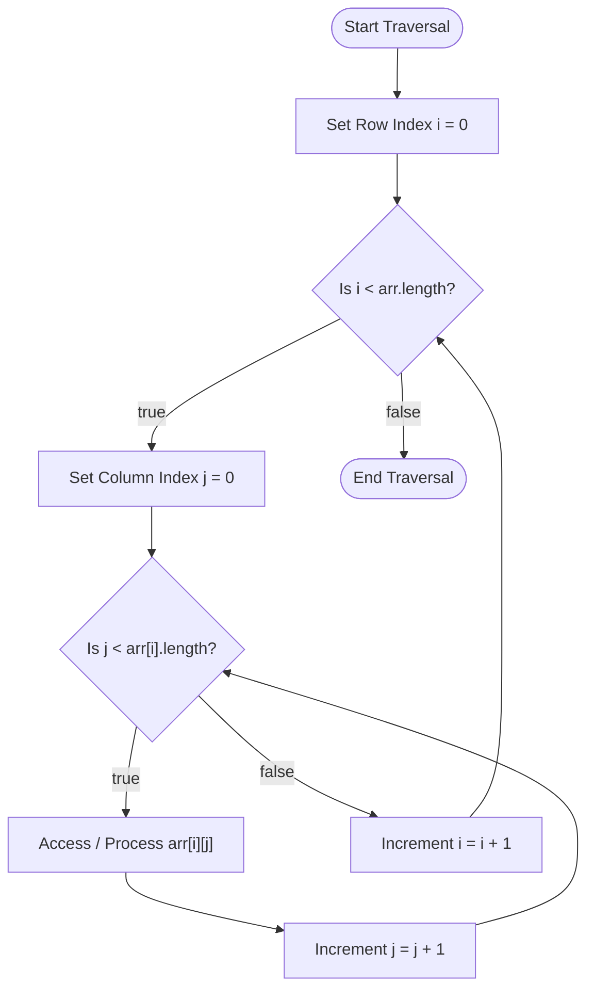

# Multi-Dimensional Arrays in Java

## Overview

In Java, a **multi-dimensional array** is essentially an **"array of arrays"** used to store data in a tabular, grid, or matrix format (rows and columns). While 1D arrays store a single linear sequence of values, 2D and 3D arrays allow developers to represent matrices, board games, image pixels, and spatial data structures efficiently.

This guide covers:

- **2D and 3D array syntax & allocation** - declaring, instantiating, and initializing multidimensional grids
- **Memory layout & calculation** - understanding dynamic heap allocation and sub-array references
- **Pure Java code examples** - matrix traversal, element modifications, 3D layer operations, and array aggregation
- **Common mistakes and traceback analysis** - fixing index out-of-bounds, uninitialized sub-arrays, and incorrect loop boundaries
- **Applications & exercises** - practical use cases, reference tables, and practice problems

---

## Table of Contents

1. [Syntax & Declaration](#syntax--declaration)
2. [Memory Architecture & Indexing](#memory-architecture--indexing)
3. [Flowchart for 2D Array Traversal](#flowchart-for-2d-array-traversal)
4. [Pure Java Code Examples](#pure-java-code-examples)
   * [Example 1: Declaring and Initializing a 2D Array](#example-1-declaring-and-initializing-a-2d-array)
   * [Example 2: Matrix Traversals and Updates](#example-2-matrix-traversals-and-updates)
   * [Example 3: Three-Dimensional (3D) Arrays](#example-3-three-dimensional-3d-arrays)
   * [Example 4: Matrix Aggregation (Even & Odd Counter)](#example-4-matrix-aggregation-even--odd-counter)
5. [Common Mistakes and Errors](#common-mistakes-and-errors)
6. [Exercises](#exercises)
7. [Quick Reference](#quick-reference)
8. [Related Topics](#related-topics)
9. [Why This Matters](#why-this-matters)
10. [Additional Resources](#additional-resources)

---

## Syntax & Declaration

### What is a Multi-Dimensional Array?

A multi-dimensional array is an array whose elements are themselves references to other arrays. In Java, 2D arrays are structured as a collection of row arrays, where each row index points to a 1D column array.

### Syntax

```java
// Declaration of a 2D array
dataType[][] arrayName;

// Allocation with fixed rows (R) and columns (C)
arrayName = new dataType[rows][columns];

// Direct literal initialization (2D Matrix)
dataType[][] arrayName = {
    { val1, val2 },
    { val3, val4 }
};

// N-Dimensional syntax
dataType[][][] array3D = new dataType[depth][rows][columns];
```

---

## Memory Architecture & Indexing

Java does not use a contiguous single-block 2D memory grid. Instead, it creates an array of references on the **Heap**, where the primary array holds references to individual 1D row arrays.

### Total Elements Formula

For an $N$-dimensional array with dimensions $d_1, d_2, \dots, d_N$, total element capacity is calculated as:

$$\text{Total Capacity} = \prod_{k=1}^{N} d_k = d_1 \times d_2 \times \dots \times d_N$$

For a 2D matrix of $R$ rows and $C$ columns:

$$\text{Total Elements} = R \times C$$

---

## Flowchart for 2D Array Traversal



### How It Works (Execution Steps)

1. **Outer Loop Control:** Iterates through each row index $i$ from $0$ to $\text{arr.length} - 1$.
2. **Inner Loop Control:** Iterates through each column index $j$ of row $i$ from $0$ to $\text{arr}[i].\text{length} - 1$.
3. **Element Access:** Computes row reference $\text{arr}[i]$ and dereferences index $j$ to perform operations in $O(1)$ time.
4. **Completion:** Exits inner loop per row and outer loop after all rows are processed.

---

## Pure Java Code Examples

### Example 1: Declaring and Initializing a 2D Array

Demonstrates basic 2D array creation, element assignment, and printing without external input.

```java
public class MultiArrayBasicDemo {
    public static void main(String[] args) {
        // Declaring and allocating a 2D array (1 row, 3 columns)
        int[][] arr = new int[1][3];

        // Assigning values via index position
        arr[0][0] = 3;
        arr[0][1] = 5;
        arr[0][2] = 7;

        // Displaying individual elements
        System.out.println("arr[0][0] = " + arr[0][0]);
        System.out.println("arr[0][1] = " + arr[0][1]);
        System.out.println("arr[0][2] = " + arr[0][2]);
    }
}
```

#### Output

```text
arr[0][0] = 3
arr[0][1] = 5
arr[0][2] = 7
```

### Explanation

* `new int[1][3]` creates a single row containing 3 integer slots initialized to default value `0`.
* Specific elements are updated using two index bounds (`arr[row][column]`).

---

### Example 2: Matrix Traversals and Updates

Demonstrates literal initialization, loop-based populating, and full matrix printing.

```java
public class MatrixTraversalDemo {
    public static void main(String[] args) {
        // Direct literal 2D array initialization
        int[][] matrixA = {
            {1, 2},
            {3, 4}
        };

        System.out.println("Literal Matrix:");
        for (int i = 0; i < matrixA.length; i++) {
            for (int j = 0; j < matrixA[i].length; j++) {
                System.out.print(matrixA[i][j] + " ");
            }
            System.out.println();
        }

        // Programmatically populated 2D array
        int rows = 2;
        int cols = 2;
        int[][] matrixB = new int[rows][cols];

        int counter = 1;
        for (int i = 0; i < rows; i++) {
            for (int j = 0; j < cols; j++) {
                matrixB[i][j] = counter++;
            }
        }

        System.out.println("\nPopulated Matrix:");
        for (int i = 0; i < rows; i++) {
            for (int j = 0; j < cols; j++) {
                System.out.print(matrixB[i][j] + " ");
            }
            System.out.println();
        }
    }
}
```

#### Output

```text
Literal Matrix:
1 2 
3 4 

Populated Matrix:
1 2 
3 4 
```

### Explanation

* Nested `for` loops traverse rows ($i$) and columns ($j$).
* `matrixA.length` gives the total row count, while `matrixA[i].length` returns the column count for row $i$.

---

### Example 3: Three-Dimensional (3D) Arrays

Demonstrates creating, initializing, and traversing a 3D array (array of 2D grids).

```java
public class ThreeDimensionalArrayDemo {
    public static void main(String[] args) {
        // Declaring a 3D array with dimensions 2 x 2 x 2
        int[][][] arr3D = {
            { {1, 2}, {3, 4} },
            { {5, 6}, {7, 8} }
        };

        int layers = arr3D.length;
        int rows = arr3D[0].length;
        int cols = arr3D[0][0].length;

        System.out.println("3D Array Elements:");
        for (int i = 0; i < layers; i++) {
            for (int j = 0; j < rows; j++) {
                for (int k = 0; k < cols; k++) {
                    System.out.println("arr3D[" + i + "][" + j + "][" + k + "] = " + arr3D[i][j][k]);
                }
            }
        }
    }
}
```

#### Output

```text
3D Array Elements:
arr3D[0][0][0] = 1
arr3D[0][0][1] = 2
arr3D[0][1][0] = 3
arr3D[0][1][1] = 4
arr3D[1][0][0] = 5
arr3D[1][0][1] = 6
arr3D[1][1][0] = 7
arr3D[1][1][1] = 8
```

### Explanation

* A 3D array is accessed using three indices: `arr[depth][row][column]`.
* Triple nested loops iterate through depth layers, row vectors, and individual columns.

---

### Example 4: Matrix Aggregation (Even & Odd Counter)

Demonstrates analyzing elements across a 2D matrix programmatically without user input dependencies.

```java
public class MatrixAggregationDemo {
    public static void main(String[] args) {
        // Sample 2D matrix
        int[][] matrix = {
            {12, 7, 9},
            {24, 18, 5},
            {3, 14, 22}
        };

        int evenCount = 0;
        int oddCount = 0;

        System.out.println("Matrix Elements:");
        for (int i = 0; i < matrix.length; i++) {
            for (int j = 0; j < matrix[i].length; j++) {
                System.out.print(matrix[i][j] + "\t");
                if (matrix[i][j] % 2 == 0) {
                    evenCount++;
                } else {
                    oddCount++;
                }
            }
            System.out.println();
        }

        System.out.println("\nSummary:");
        System.out.println("Even numbers count: " + evenCount);
        System.out.println("Odd numbers count: " + oddCount);
    }
}
```

#### Output

```text
Matrix Elements:
12	7	9	
24	18	5	
3	14	22	

Summary:
Even numbers count: 5
Odd numbers count: 4
```

### Explanation

* Demonstrates matrix processing by visiting every element, checking modulo condition (`% 2 == 0`), and aggregating totals.

---

## Common Mistakes and Errors

### Mistake 1: Incorrect Column Boundary in Nested Loops

Hardcoding fixed column bounds across non-uniform or dynamically sized matrices triggers `ArrayIndexOutOfBoundsException`.

```java
int[][] matrix = {
    {1, 2, 3},
    {4, 5} // Row 1 has only 2 elements
};

for (int i = 0; i < matrix.length; i++) {
    for (int j = 0; j < 3; j++) { // Error: row 1 index 2 is invalid!
        System.out.print(matrix[i][j] + " ");
    }
}
```

### Traceback Error Analysis

```text
Exception in thread "main" java.lang.ArrayIndexOutOfBoundsException: Index 2 out of bounds for length 2
    at Main.main(Main.java:9)
```

* **File and Line Number:** `Main.java:9`
* **Root Cause:** Hardcoded inner loop condition `j < 3` attempted to access `matrix[1][2]` which does not exist.
* **Resolution:** Use `j < matrix[i].length` to dynamically evaluate each row's actual length.

---

### Mistake 2: Accessing Unallocated Row References

Instantiating a 2D array with row count only (`new int[3][]`) leaves individual row arrays unallocated (`null`).

```java
int[][] arr = new int[3][];
arr[0][0] = 10; // NullPointerException at runtime!
```

### Traceback Error Analysis

```text
Exception in thread "main" java.lang.NullPointerException: Cannot store to int array because "arr[0]" is null
    at Main.main(Main.java:3)

```

* **Root Cause:** `new int[3][]` allocates space for 3 row pointers initialized to `null`.
* **Correction:** Instantiate each sub-array before assignment: `arr[0] = new int[4];`.

---

## Exercises

### Exercise 01: Matrix Diagonal Sum

Write a program that initializes a square $3 \times 3$ integer matrix and calculates the sum of both the primary diagonal and secondary diagonal elements.

* **Solution:** [Exercise 01: Matrix Diagonal Sum](https://www.google.com/search?q=labs/exercise-01.matrix_diagonal_sum.java)

### Exercise 02: Matrix Transposition

Write a program that takes a $2 \times 3$ matrix and creates its transpose ($3 \times 2$ matrix), swapping row indices with column indices.

* **Solution:** [Exercise 02: Matrix Transposition](https://www.google.com/search?q=labs/exercise-02.matrix_transposition.java)

### Exercise 03: Row-Wise Maximum Value Finder

Write a program that traverses a 2D matrix and prints the maximum value contained in each row.

* **Solution:** [Exercise 03: Row-Wise Maximum Value Finder](https://www.google.com/search?q=labs/exercise-03.row_wise_maximum_value_finder.java)

---

## Quick Reference

| Concept | Syntax / Pattern | Description |
| --- | --- | --- |
| 2D Declaration | `int[][] arr = new int[R][C];` | Allocates $R$ rows and $C$ columns filled with zero values |
| Literal 2D Matrix | `int[][] arr = {{1, 2}, {3, 4}};` | Directly creates and populates a $2 \times 2$ matrix |
| Row Count | `arr.length` | Total number of row arrays |
| Column Count | `arr[i].length` | Total number of elements in row $i$ |
| 3D Access | `arr[d][r][c]` | Accesses element at depth $d$, row $r$, and column $c$ |

---

## Related Topics

* [Introduction to Array](../introduction_to_array/introduction_to_array.md)

---

## Why This Matters

Multi-dimensional arrays are fundamental for representing structured spatial data such as mathematical matrices, 2D game boards (tic-tac-toe, chess), pixel data in image processing, and dynamic programming tables. Mastering row-column indexing and dynamic sub-array bounds is critical for algorithmic problem-solving and software engineering.

---

## Additional Resources

* [GeeksforGeeks: Multidimensional Arrays in Java](https://www.geeksforgeeks.org/multidimensional-arrays-in-java/)

---

## Key Takeaways

* Java multi-dimensional arrays are "arrays of arrays" allocated on the Heap.
* Elements in a 2D matrix are accessed via `arr[row_index][column_index]` with $O(1)$ lookup time.
* Total element capacity for multi-dimensional arrays equals the product of all dimension sizes.
* Dynamic row bounds should always use `j < arr[i].length` to prevent `ArrayIndexOutOfBoundsException`.
* Sub-arrays must be allocated before element assignment to avoid `NullPointerException`.

---

*Last Modified : October 25, 2026*
